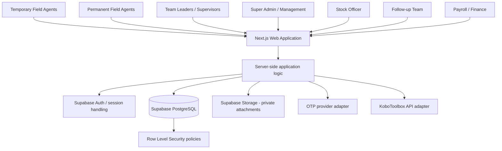
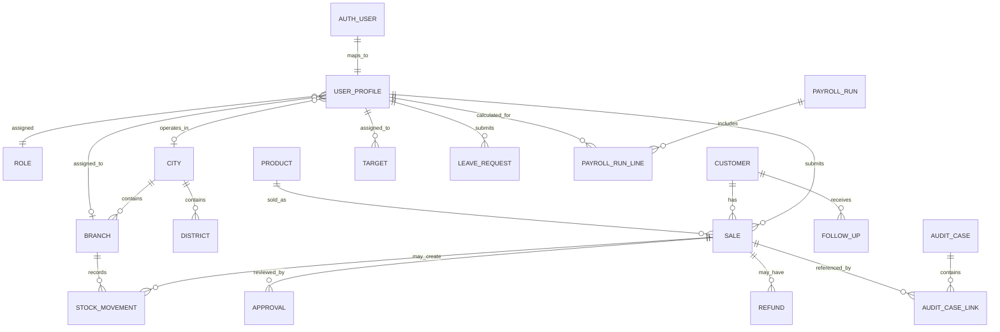
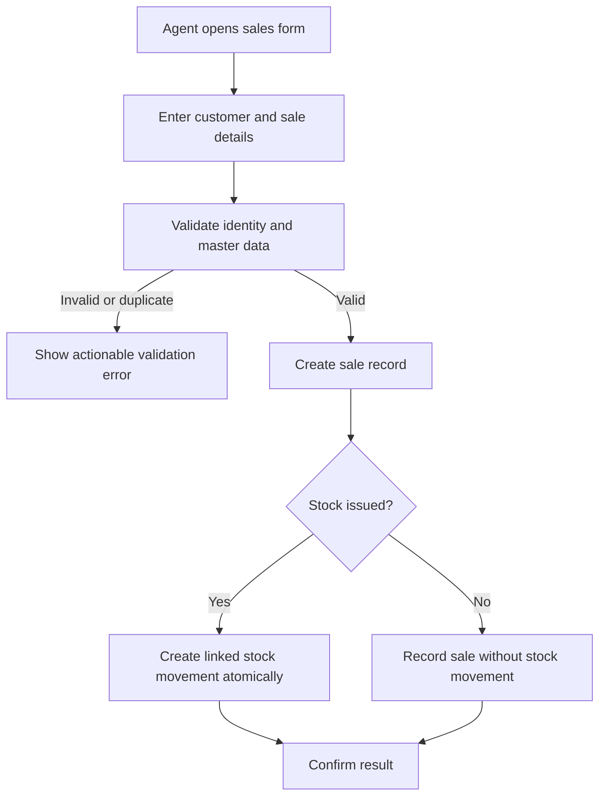
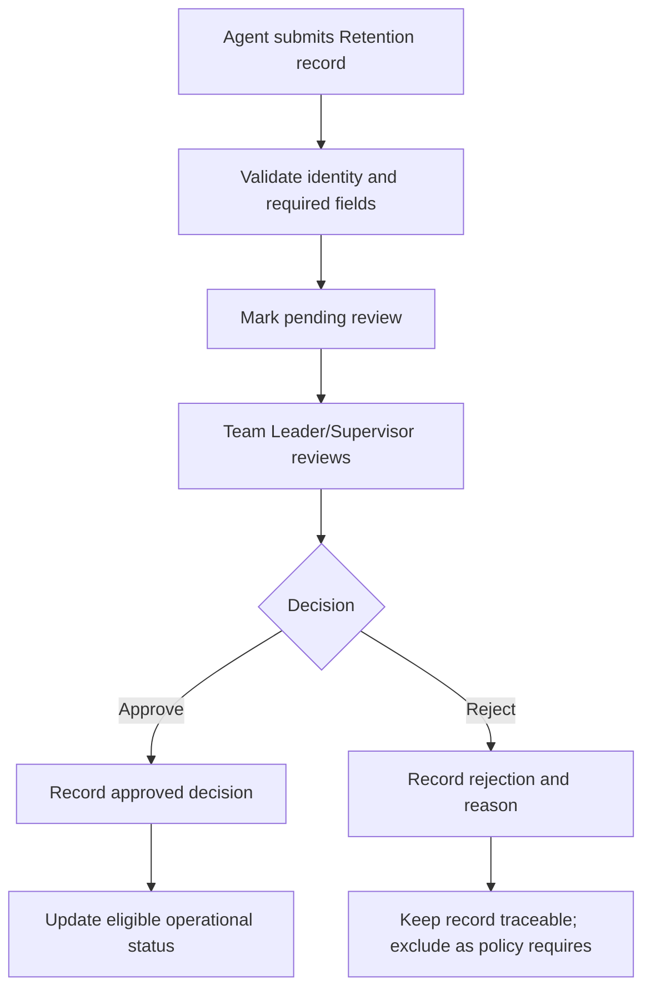
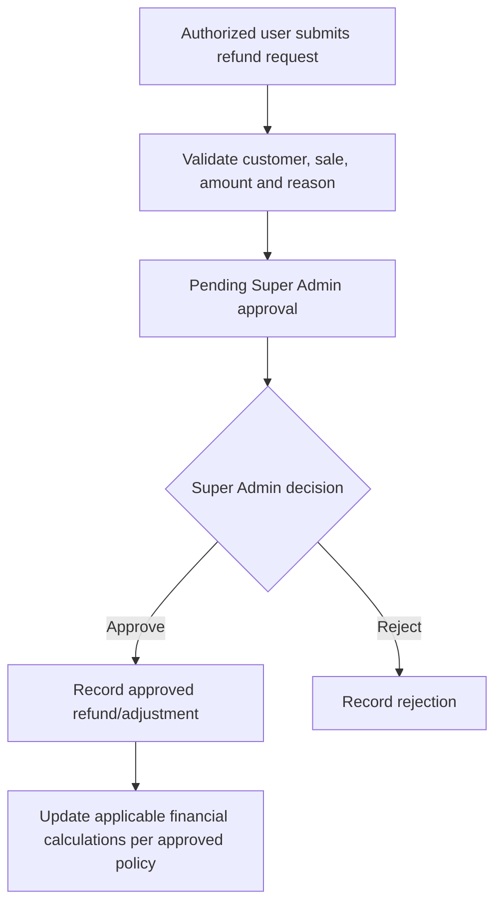

# Sogasho Outdoor Field Sales, Performance Analytics & Audit Control System
## System Design Document (SDD)

**Document version:** 1.0  
**Status:** Draft for technical review and stakeholder validation  
**Business owner:** Sogasho ISP — Outdoor Sales / Commercial Department  
**Technology baseline:** Next.js + Supabase  
**Operating cities in the BRD:** Hargeisa, Burco, Berbera, Borama  
**Companion documents:**
- `Sogasho_Outdoor_Field_Sales_Audit_System_BRD.md`
- `Sogasho_Outdoor_Field_Sales_Audit_System_Claude_Code_Roadmap_Phase_0_to_19.md`

> **Document rule:** The BRD is the source of business requirements. This SDD translates those requirements into a proposed technical design. Where the BRD does not settle a technical or business decision, this document labels the choice as a **proposed design** or **decision required** rather than treating it as confirmed policy.

---

# 1. Purpose and audience

This System Design Document describes the proposed architecture, application boundaries, data model, authorization model, key workflows, integration boundaries, quality controls, and deployment approach for the Sogasho Outdoor Field Sales, Performance Analytics & Audit Control System.

It is intended for:
- Claude Code and the developers implementing the system phase by phase.
- Sogasho Super Admin and operational stakeholders.
- Outdoor Sales management and Team Leaders/Supervisors.
- Follow-up Team, Stock Officer, Payroll/Finance, audit reviewers, and QA.
- The business owner responsible for accepting business-policy decisions.

The system must be built in incremental phases. This document is not authorization to implement all modules in one coding session. Follow the roadmap and implement only the currently approved phase.

# 2. Design objectives

The design aims to provide:

1. A central, traceable record of outdoor sales and customer registration.
2. Strong uniqueness and validation for customer phone number and Index Number.
3. Controlled approval of Retention sales and refunds.
4. Traceable stock receipts, issues, and balances.
5. Customer follow-up and Active/Expire tracking.
6. Duplicate detection and reviewable audit cases.
7. Reliable dashboards, reports, and payroll calculations from source records.
8. Role-based access enforced by server-side checks and Supabase Row Level Security (RLS).
9. OTP and KoboToolbox integration boundaries that can be configured without exposing secrets.
10. A codebase that can be implemented, tested, and reviewed one roadmap phase at a time.

# 3. System context

## 3.1 High-level context



**Architecture principle:** the browser is a presentation layer, not a trusted authority. All privileged business operations must be validated on the server and protected at the database boundary where applicable.

## 3.2 System users and external systems

| Actor/system | Main responsibility |
|---|---|
| Temporary Agent | Register sales, view permitted personal performance, use phone-based login flow |
| Permanent Agent | Register sales and access permitted modules using email-based login |
| Team Leader/Supervisor | Review and decide Retention submissions; review team performance where authorized |
| Super Admin | Manage users/settings, approve refunds, review audit alerts, administer access |
| Stock Officer | Record stock receipts and relevant stock operations |
| Follow-up Team | Follow up with customers and update Active/Expire status |
| Payroll/Finance | Review payroll totals and supporting calculations, subject to assigned access |
| Management | Review dashboard, reports, targets, and performance |
| OTP provider | Deliver one-time verification codes or alerts according to configured provider capability |
| KoboToolbox | Supply market insight/survey data through its API |

The exact access permissions for each role must be confirmed and implemented in the permissions phase. A role label alone is not sufficient to authorize an action.

# 4. Scope and module boundaries

The system includes these business modules:

1. Authentication and sessions.
2. User, role, permission, and menu administration.
3. Master data and system settings.
4. Targets and KPI assignments.
5. Stock receiving, issuing, and balance reporting.
6. Sales registration and validation.
7. Retention approvals.
8. Product switches (FTTA/FTTH as described in the BRD).
9. Refund requests and Super Admin approval.
10. Customer follow-up and Active/Expire status.
11. Duplicate detection, audit cases, and alerts.
12. Dashboard and operational analytics.
13. Reports, filters, and exports.
14. Payroll and incentive calculations.
15. Leave management and private attachments.
16. OTP integration.
17. KoboToolbox survey integration.
18. Agent performance recognition.

## 4.1 Out of scope for this design unless separately approved

- Replacing Sogasho's core CRM, billing, ERP, or network provisioning systems.
- Automatic payment collection or banking integrations not specified in the BRD.
- Automatic proof of fraud. A duplicate/suspicion flag is an investigation signal, not a final conclusion.
- A native mobile application; the baseline is a web application.
- Offline-first synchronization unless separately approved and designed.
- Any integration credentials or endpoints not supplied by Sogasho.

# 5. Technology architecture

## 5.1 Baseline

| Layer | Proposed technology | Design notes |
|---|---|---|
| Web application | Next.js + TypeScript | Use existing repository conventions; choose App Router only if consistent with the project |
| UI styling/components | Existing project UI system; otherwise a consistent accessible component approach | Avoid unnecessary dependency additions |
| Authentication | Supabase Auth plus server-side identity mapping | Phone-based temporary-agent login may need a documented custom mapping/OTP flow; validate provider capabilities before implementation |
| Database | Supabase PostgreSQL | Version all schema changes as migrations |
| Authorization | Server-side permission checks + PostgreSQL RLS | Never rely only on hidden navigation items |
| Private file storage | Supabase Storage | Signed/authorized access for leave attachments |
| External integrations | Server-side adapters | OTP and KoboToolbox credentials remain server-side |
| Testing | Unit, integration, and end-to-end tests appropriate to the repository | Do not claim tests pass unless executed |
| Hosting | To be selected by Sogasho | Deployment target and environments require confirmation |

## 5.2 Logical application layers

```text
Presentation (Next.js pages/components)
        |
        v
Route handlers / Server Actions / server-only services
        |
        +---- Authentication & session context
        |
        +---- Authorization / permission policy
        |
        +---- Domain services
        |       - Sales
        |       - Stock
        |       - Approvals
        |       - Audit
        |       - Reporting
        |       - Payroll
        |       - Leave
        |
        +---- Integration adapters
        |       - OTP
        |       - KoboToolbox
        |
        v
Supabase PostgreSQL + RLS + private Storage
```

**Implementation note:** use one consistent server-side mutation pattern throughout the application. Do not mix uncontrolled browser writes with privileged server writes.

## 5.3 Suggested repository organization

Adapt this to the existing repository instead of restructuring it unnecessarily.

```text
src/
  app/
    (auth)/
    (dashboard)/
    api/                         # only where route handlers are appropriate
  components/
    layout/
    navigation/
    forms/
    tables/
    feedback/
  features/
    auth/
    users/
    settings/
    targets/
    stock/
    sales/
    retention/
    product-switches/
    refunds/
    follow-up/
    audit/
    dashboard/
    reports/
    payroll/
    leave/
    performance/
  lib/
    supabase/
      browser-client.ts
      server-client.ts
      middleware.ts              # if required by chosen Next.js setup
    auth/
    permissions/
    validation/
    errors/
    logging/
  server/
    services/
    repositories/
    integrations/
      otp/
      kobo/
supabase/
  migrations/
  seed.sql                       # development/demo data only, if needed
docs/
  implementation/
    ROADMAP.md
    PHASE_LOG.md
    DECISIONS.md
```

This is a proposed organization, not a requirement to create all folders during Phase 1.

# 6. Authentication and identity

## 6.1 Login requirements

- Temporary agents: phone number and password.
- Permanent users: email and password.
- Super Admin creates/activates/disables users and assigns access.
- A generated temporary password or secure invitation method is required by the BRD.
- The first-login password-change requirement must be implemented if supported by the approved authentication design.
- OTP delivery for temporary-agent sign-in is part of the stated integration requirements.

## 6.2 Important Supabase design constraint

Supabase Auth does not mean that every desired sign-in method is automatically available with the exact UI/credential combination in the BRD. Before implementation, the team must confirm the supported approach for phone-number-plus-password, OTP delivery, and permanent email/password login.

**Proposed approach:** maintain a private application user profile linked to the Supabase Auth user ID. Implement a server-side authentication adapter that maps the approved phone login process to the supported Supabase identity mechanism. Do not store plaintext passwords, create a homemade password system, or expose service-role credentials to the browser.

If the exact phone + password flow cannot be implemented securely with the selected provider configuration, stop and present options for business approval rather than silently changing the login policy.

## 6.3 Session rules

- Protected pages require a valid authenticated session.
- Sensitive mutations re-check the session and permission on the server.
- Disabled users must be prevented from continuing normal access according to a documented session revocation policy.
- Tokens and passwords must not be written to logs.
- Session refresh and cookie behavior must follow the selected Next.js/Supabase integration pattern.

# 7. Authorization model

## 7.1 Role-based permissions

The BRD identifies these role concepts: Super Admin, temporary/permanent agents, Team Leaders/Supervisors, Follow-up Team, Payroll/Finance, Stock Officer, and management. Exact permission assignments should be stored/configured rather than scattered as hard-coded role checks.

**Proposed design:** permission-based authorization with roles assigned sets of permissions.

Example permission keys:

```text
users.read
users.create
users.update
users.disable
settings.manage
targets.assign
stock.receive
stock.issue
stock.read
sales.create
sales.read_own
sales.read_team
sales.read_city
retention.review
refunds.submit
refunds.approve
followup.update
audit.read
audit.resolve
reports.read
reports.export
payroll.read
payroll.calculate
payroll.finalize
leave.request
leave.review
leave.assign
performance.read
```

These keys are a design proposal. Final permission mapping requires stakeholder approval.

## 7.2 Enforcement layers

1. **Navigation/UI:** show only modules permitted for the current user.
2. **Server:** validate identity, permission, scope, and input on every protected operation.
3. **Database:** use RLS for user-scoped data and protect exposed tables.
4. **Storage:** keep attachments private and validate access before issuing signed URLs.
5. **Audit:** record sensitive administrative and approval decisions.

Hiding a button or menu item is not a security boundary.

## 7.3 Data scope

Potential data scopes include own records, team records, branch records, city records, and system-wide records. The scope for each role must be documented before the corresponding module is implemented.

# 8. Domain model and database design

This section defines the proposed logical entities. It is not a final SQL migration. Exact columns, constraints, enums, and RLS policies must be implemented and tested in the appropriate roadmap phase.

## 8.1 Entity relationship overview



The diagram is logical and may be refined during Phase 2. For example, approval records may be specialized by workflow, and product switches may use their own entity rather than a normal sale.

## 8.2 Proposed core entities

| Entity | Purpose | Important design considerations |
|---|---|---|
| `user_profiles` | App profile linked to authenticated user | Employment type, role/permission assignment, active status, city/branch, first-login state if needed |
| `roles` | Named role definitions | Must not be the only authorization source if fine-grained permissions are needed |
| `permissions` / `role_permissions` | Configurable access rights | Changes restricted to authorized administrators |
| `cities` | Operating cities | Seed the four cities stated in the BRD; avoid hard-coded duplication |
| `branches` | Branch catalog | Linked to city where applicable |
| `districts` | District dropdown values | City-scoped and maintained by authorized users |
| `products` | Product catalog and active status | FTTA/FTTH/FTTB/LTE and other products only as confirmed by the BRD and master data |
| `product_prices` | Product/price values | Effective dates/versioning may be needed; confirm historical pricing rules |
| `customers` | Canonical customer identity | Phone and Index Number uniqueness must be enforced according to the approved identity model |
| `sales` | Sales registrations and lifecycle | Agent, customer, product, price, branch, city, district, area, New/Retention type, status and timestamps |
| `sale_approvals` | Retention review history | Reviewer, decision, reason, timestamp; avoid overwriting decision history |
| `product_switches` | FTTA/FTTH product changes | From/to product, customer identity, stock impact if applicable |
| `refunds` | Refund requests and decisions | Amount, reason, requester, Super Admin decision, link to original sale |
| `stock_items` | Inventory item catalog | Resolve BDCOM/PDCOM naming before production data setup |
| `stock_movements` | Append-oriented stock ledger | Receipt/issue/adjustment reference, quantity, location, actor, reason, source entity |
| `customer_follow_ups` | Scheduled/recorded follow-up | Customer, period, status Active/Expire, assigned user, completion data |
| `audit_cases` | Reviewable duplicate/suspicion cases | Rule, evidence links, status, reviewer, resolution |
| `audit_case_records` | Link audit case to relevant records | Supports multiple related sales/users/customers |
| `targets` | Target assignment | Agent/team/city, period, target values, creator |
| `leave_requests` | Employee leave requests | Type, dates, reason, days, status, reviewer |
| `private_attachments` | Metadata for stored files | Storage path, owner record, uploader, access metadata; files remain private |
| `payroll_runs` | Payroll period and run metadata | Period, status, creator/reviewer, finalized timestamp |
| `payroll_run_lines` | Per-agent calculation snapshot | Unit counts, revenue, base pay, incentive, gross pay, calculation version |
| `integration_events` | External integration result tracking | Provider, operation, status, safe error details, retry metadata; never store secrets |
| `notifications` | In-app alert records if implemented | Recipient, type, link, read status, created timestamp |
| `activity_log` | Sensitive business activity history | Actor, action, entity, timestamp, safe before/after metadata where appropriate |

Names are proposed and may be adjusted to match existing repository conventions. Do not create all these tables in Phase 2; introduce them in the phase that owns the feature, with migrations and RLS.

## 8.3 Data integrity rules

- Phone number and Index Number must not be duplicated across valid customer/sales records, according to the BRD's uniqueness requirement and the final approved identity model.
- Enforce uniqueness in the database, not only with client-side validation.
- If phone number or Index Number can legitimately change, the change process must preserve history and require appropriate authorization.
- Every sale must reference valid master data and an authenticated submitting agent.
- Every approval must identify the reviewer, decision, and timestamp.
- Stock balance must be derived from controlled stock movements or maintained transactionally from them; avoid untraceable manual balance edits.
- Refunds must reference the original sale where possible and must not delete the original sale.
- Product switches must be distinct from new sales to avoid double counting.
- Payroll should retain a calculation snapshot or equivalent reproducible detail.
- Audit findings must be distinguishable from automated flags.
- All timestamps should be stored consistently in UTC and rendered in the intended business timezone. Confirm the business timezone configuration before deployment.

## 8.4 Stock ledger model

**Proposed design:** use a movement ledger rather than treating a single editable balance field as the only record of truth.

Movement types may include:
- Receipt from Stock Officer.
- Issue to customer linked to a sale.
- Return or reversal, if approved and supported.
- Authorized adjustment with reason.
- Other movement types only when approved by the stock process owner.

Each movement should record the item, quantity, location, actor, timestamp, source/reference, and reason where relevant. A transaction must prevent a sale retry from deducting stock twice.

The BRD's item terminology includes WiFi Router, CALIX, and inconsistent references to BDCOM/PDCOM. Confirm the correct name before production setup.

# 9. Sales and customer lifecycle

## 9.1 New sale flow



The precise transaction boundary depends on the approved business flow. When stock is issued as part of the sale, sale creation and stock deduction should succeed or fail together.

## 9.2 Sale fields from the BRD

The sales form includes:
- Customer Name.
- Phone.
- Index Number.
- District dropdown.
- Area.
- City, defaulted from agent location.
- Product.
- Price.
- Branch.
- Stock given: WiFi Router, BDCOM and CALIX as stated, with BDCOM/PDCOM terminology to confirm.
- Customer Type: New or Retention.

The data model may normalize customer identity into a customer record linked to sales. The user-facing form should preserve the fields and workflow described in the BRD.

## 9.3 Retention approval flow



Retention sales require Team Leader/Supervisor approval. The exact rules for stock deduction timing and payroll eligibility for pending/rejected Retention records must be explicitly decided before implementation of those effects.

## 9.4 Product switch

The BRD specifies customer name, phone, Index Number, branch, city default, From Product FTTA/FTTH, To Product FTTA/FTTH, and stock given (WiFi Router, BDCOM, CALIX).

The system should validate that identity fields match the existing customer record. A product switch is a separate event and must not automatically be counted as a new sale unless an approved business rule says otherwise.

## 9.5 Refund flow



Refund reasons in the BRD:
- Out of boundary.
- Technical delay.
- Refused.
- No signal.
- Other.

Refund approval must not erase the original sale or its audit history.

# 10. Duplicate detection and audit design

## 10.1 Purpose

The audit module should identify duplicate or suspicious records and notify Super Admin. A system-generated flag is a reason to investigate, not proof of intentional fraud.

## 10.2 Candidate checks

The BRD explicitly requires duplicate detection. Additional checks below are design candidates and should be configured/approved before being treated as policy:
- Duplicate phone number.
- Duplicate Index Number.
- Same identity identifier associated with multiple agents.
- Repeated submissions or near-identical records.
- Conflicting identity fields between a product switch and the existing customer.
- Suspicious patterns supported by available data.

## 10.3 Audit case lifecycle

```text
Detected
   |
   v
Open / Unreviewed
   |
   +----> Under Review
               |
               +----> Confirmed Issue
               |
               +----> False Positive
               |
               +----> Inconclusive / More Information Needed
```

The status names above are proposed. Confirm the final statuses with the audit owner.

Each case should include:
- Detection rule and explanation.
- Linked records and relevant identifiers.
- Detection timestamp.
- Reviewer and review timestamps.
- Notes and resolution.
- History of status changes.
- Notification state if notifications are implemented.

Do not automatically label a person or transaction as fraudulent solely because a duplicate rule triggered. Do not silently modify payroll eligibility based on an unreviewed flag.

# 11. Stock management design

The BRD calls for receiving stock, deducting stock given to customers on New/Retention flows, and a report of received versus remaining stock.

## 11.1 Proposed operations

- Receive stock from Stock Officer.
- Record stock issued to a customer.
- Associate an issue with the sale where appropriate.
- Show received, issued, and remaining quantities.
- Record movement references and actors.
- Prevent negative balances and duplicate issue transactions.
- Keep stock history available for audit.

## 11.2 Balance calculation

A basic item/location balance is:

```text
Opening balance
+ receipts
+ approved returns/reversals
+ authorized positive adjustments
- customer issues
- authorized negative adjustments
= closing balance
```

This is a proposed accounting model; movement categories and opening-balance import rules must be agreed before production.

# 12. Customer follow-up design

The BRD requires customers registered in the first month to be followed up in the second month. Required fields include Customer Name, Index Number, Phone, Branch, City, Customer Type, and Active/Expire status.

**Proposed design:**
- Derive eligible follow-up records from registration date and the approved follow-up period.
- Prevent duplicate follow-up tasks for the same customer and period.
- Record the responsible follow-up user, completion time, status, and relevant notes if approved.
- Keep follow-up status separate from sale approval status.
- Show unresolved/missing customer information for correction by an authorized user.

Clarify whether follow-up is generated for all customer types, whether status is manually confirmed or imported from another system, and how late registrations are handled.

# 13. Dashboard, reporting, and targets

## 13.1 Dashboard metrics

The BRD requires:
- Units sold.
- Units by product.
- Revenue.
- City breakdown.
- New and Retention breakdown.
- Overall totals and monthly totals.

The dashboard must clearly identify the date period and the records included in each metric. Pending approvals, rejected sales, refunds, duplicate records, and product switches must follow explicit metric definitions.

## 13.2 Reports

The BRD specifies reports by:
- City.
- Product.
- Price.
- Agent.
- Week.
- Month.
- Quarter.
- Six months.
- Year.
- Active versus Expire by New/Retention.

Branch filtering is also included in the expanded BRD/roadmap. Export formats, maximum export size, and who may export personal data require confirmation.

## 13.3 Targets and KPIs

The BRD includes target/KPI assignment. Store targets separately from actual performance records. Actual achievement should be calculated from eligible source records rather than entered manually.

## 13.4 Consistent metric definitions

Create a shared server-side query/service layer for report and dashboard definitions so different screens do not calculate “sales,” “revenue,” or “eligible units” differently. Where database views or functions are used, document their business definitions and test them against sample fixtures.

# 14. Payroll and incentive calculation design

## 14.1 Required fields

The BRD lists:
- Month.
- Agent.
- City.
- FTTA/FTTH/FTTB/LTE units selected from system sales.
- Grand Total.
- New and Retention count, required to match 100% of Grand Total.
- Revenue.
- System-generated incentive.
- Temporary-agent base salary of $100.
- Permanent staff incentive only.
- Gross pay = base salary + incentive.
- Totals for products, New, Retention, revenue, incentive, base salary, and gross pay.

## 14.2 Incentive rule confirmed by the user

**Incentive = $5 per eligible monthly sale above 15. The first 15 eligible sales earn no incentive.**

```text
incentive = max(0, eligible_monthly_sales - 15) * 5
```

| Eligible monthly sales | Incentive |
|---:|---:|
| 14 | $0 |
| 15 | $0 |
| 16 | $5 |
| 20 | $25 |
| 25 | $50 |
| 30 | $75 |

## 14.3 Proposed calculation process

1. Select the payroll month and agent.
2. Query source sales using the approved eligibility rules.
3. Calculate product counts, New/Retention counts, and revenue.
4. Validate that New + Retention counts reconcile to the Grand Total, or flag a mismatch.
5. Calculate incentive using the confirmed threshold formula.
6. Apply base salary based on employment category.
7. Calculate gross pay.
8. Save the calculation details/snapshot for reproducibility.
9. Restrict finalization to authorized roles and preserve a record of finalization.

## 14.4 Decision required: eligibility policy

Before Phase 15 is implemented, the business owner must define whether/how the following affect payroll:
- Pending or rejected Retention records.
- Refunded sales.
- Duplicate or audit-flagged records.
- Reversed or corrected records.
- Product switches.
- Sales entered late or corrected after a payroll run.

Do not infer the answers. Keep calculations explainable and make unresolved records visible for review.

# 15. Leave management and file storage

The BRD includes:
- Employee Name.
- Department, default Outdoor.
- Date range.
- Number of days.
- Reason.
- Type: Annual, Sick, Maternity.
- File attachment signed by Super Admin.
- Super Admin assignment of annual leave and approval of requests.

## 15.1 Proposed design

- Store leave metadata in the database and file bytes in a private storage bucket.
- Validate date range and number of days.
- Store request status, submitter, reviewer, decision, and timestamps.
- Only authorized users can access signed attachments.
- Use signed URLs or authenticated download handlers with short-lived access.
- Restrict file size and accepted content types based on an approved policy.
- Do not make leave attachments publicly accessible.

The BRD does not define a complete leave accrual, public-holiday, or working-day calendar. Do not invent one without approval.

# 16. Integration design

## 16.1 OTP provider

The BRD calls for temporary-agent sign-in OTP and notifications for audit/duplicate alerts.

Design an adapter boundary so the application does not depend directly on one provider's SDK throughout the codebase. Store credentials only in server-side environment variables. Record delivery outcomes without logging OTP values, secrets, or sensitive message content.

Confirm:
- Provider and account.
- Supported destination format.
- Delivery limits and costs.
- OTP expiration, retry limits, and lockout policy.
- Which notifications use OTP versus ordinary alerts.

## 16.2 KoboToolbox

The BRD requires KoboToolbox API integration for market-insight data.

Proposed flow:
1. Authorized server-side job/request calls the configured KoboToolbox API.
2. Validate the response schema and required fields.
3. Store imported survey data separately from canonical sales/customer records.
4. Record import timestamp, source reference, and safe error information.
5. Prevent repeated imports from creating duplicate survey records.
6. Expose aggregate market insights only to authorized roles.

Confirm survey form identifiers, field mappings, refresh frequency, and data-retention rules before the integration phase.

## 16.3 Integration failure handling

- Use timeouts and safe retry strategies.
- Do not retry non-idempotent actions unless an idempotency strategy exists.
- Record integration status and a safe error summary.
- Avoid placing tokens, passwords, OTPs, or sensitive customer information in logs.
- Provide a clear failure state and a documented manual recovery path.

# 17. Notifications

The BRD mentions duplicate/fraud alerts and OTP notifications. In-app notifications and provider delivery behavior should be designed around approved use cases.

Potential notification event types:
- Duplicate detected.
- Audit case created or assigned.
- Retention awaiting review.
- Refund awaiting approval.
- OTP delivery outcome.
- Integration failure requiring an administrator.

Each event must have an explicit recipient rule. Avoid sending sensitive customer details in SMS messages; link to an authenticated application view where appropriate.

# 18. API and service boundary design

The exact implementation may use Next.js Server Actions, route handlers, or server-only services. Choose a consistent pattern based on the repository. The following are logical operations, not a mandate to create REST endpoints with these exact URLs.

| Domain | Logical operations |
|---|---|
| Authentication | Sign in, sign out, refresh/validate session, first-login password update |
| Users | List, create/invite, update profile, activate/disable, assign role and scope |
| Settings | Manage cities, branches, districts, products, prices, customer types, stock items |
| Targets | Create/update target, list targets, calculate achievement |
| Stock | Receive stock, issue stock, view balance, view movement history |
| Sales | Create sale, list permitted sales, validate customer identity, view sale details |
| Retention | Submit retention, approve/reject, view review history |
| Product switches | Create switch, validate customer, record stock effect |
| Refunds | Submit request, approve/reject, view linked sale and decision history |
| Follow-up | Generate/list due follow-ups, record status, view history |
| Audit | Detect duplicates, create/review/resolve cases, notify Super Admin |
| Dashboard | Query period totals and approved breakdowns |
| Reports | Apply filters, generate report, export authorized data |
| Payroll | Calculate, reconcile, review, finalize, retrieve historical snapshot |
| Leave | Request, assign, approve/reject, upload/access private attachment |
| Integrations | Test provider configuration, import Kobo data, review integration status |
| Performance | Calculate ranking, top product, top branch |

All operations that change business records must validate permissions, input schema, and relevant business invariants on the server.

# 19. Error handling and validation

## 19.1 Validation

Use shared schema validation for:
- Required fields.
- Phone and Index Number format.
- Unique customer identifiers.
- Numeric prices and refund amounts.
- Positive stock quantities.
- Date ranges and payroll periods.
- Valid master-data references.
- Role-specific allowed operations.
- Approval status transitions.

Database constraints must back up critical validation. Client validation improves usability but is not sufficient.

## 19.2 Error response principles

- Return a user-safe message that explains how to correct a normal validation error.
- Do not expose database internals, stack traces, secrets, or private records.
- Log technical diagnostics server-side with sensitive fields removed.
- Distinguish authorization failure, validation failure, conflict/duplicate, external integration failure, and unexpected system error.
- Use idempotency protection for retried mutations where duplicate execution could affect stock, sales, refunds, or payroll.

# 20. Auditability and data history

The system handles operational and financial records. It should preserve who did what and when for sensitive actions.

Recommended audited events:
- User activation/deactivation and role changes.
- Master-data changes affecting future transactions.
- Sales creation and correction.
- Retention approval/rejection.
- Refund decision.
- Stock receipt, issue, adjustment, and reconciliation.
- Audit case status changes.
- Payroll calculation and finalization.
- Leave approval/assignment.
- Integration configuration changes.

The exact immutability and retention requirements need stakeholder confirmation. At minimum, ordinary users should not be able to silently erase critical historical activity. Use append-oriented history for stock and decision records where appropriate.

# 21. Security design

## 21.1 Required safeguards

- RLS on exposed tables containing protected data.
- Server-side authorization on every sensitive action.
- Least-privilege role assignments.
- Server-only use of Supabase service-role credentials, if such credentials are required at all.
- No secrets in source control or client bundles.
- Private file storage for leave attachments.
- Input validation and output escaping appropriate to the framework.
- Rate limits or abuse controls for authentication and OTP operations.
- Safe handling of duplicate alerts and sensitive audit data.
- No plaintext passwords or OTPs in logs.
- Environment separation for local, test, staging, and production.
- Versioned migrations and reviewed schema changes.

## 21.2 Privacy and data minimization

- Expose customer phone/Index Number only to roles with a business need.
- Export only the columns required for the selected report and user's permission.
- Avoid copying production customer data into local fixtures or test environments.
- Define retention and deletion requirements with the business owner before production deployment.
- Review who can see payroll and audit investigation details.

## 21.3 Security verification

Phase 19 must include direct tests that unauthorized users cannot bypass UI controls by calling a server operation or database endpoint directly. Test RLS behavior using appropriate non-admin identities.

# 22. Non-functional requirements

The system should be assessed against these quality attributes. Exact numeric service-level targets require business approval.

| Attribute | Design expectation |
|---|---|
| Security | Server-side permission checks, RLS, private storage, secrets management |
| Integrity | Database constraints, transactional business mutations, traceable adjustments |
| Reliability | Useful error states, safe retries, migration discipline, backup/recovery plan |
| Performance | Paginated tables, indexed filters, server-side aggregation for reports |
| Usability | Clear forms, responsive layout, accessible controls, helpful validation |
| Maintainability | Feature boundaries, shared validation, documented decisions, automated tests |
| Auditability | Traceable approvals, stock movements, payroll snapshots, sensitive actions |
| Compatibility | Current supported browsers and devices agreed by Sogasho |
| Localization | Confirm preferred display language, currency format, and business timezone |
| Observability | Safe error logs and integration status without secrets or unnecessary PII |

# 23. Performance and query design

- Index fields commonly used for uniqueness, joins, authorization scopes, and filters.
- Candidate indexes include customer phone, Index Number, sale date, agent, city, branch, product, status, and payroll period. Final indexes should follow the actual schema and query plans.
- Paginate large sales, audit, and stock-movement tables.
- Use server-side aggregation or database views/functions for dashboard/report totals where appropriate.
- Avoid fetching all sales into the browser to calculate company-wide totals.
- Test realistic data volumes before release.
- Avoid adding indexes blindly; confirm query plans and migration impact.

# 24. Testing strategy

## 24.1 Unit tests

Test pure business logic such as:
- Incentive threshold calculation.
- Gross pay calculation.
- Report-period boundaries.
- Stock balance calculation.
- Sale eligibility rules once approved.
- Validation and status transitions.

## 24.2 Integration tests

Test:
- Database constraints and RLS.
- Sale creation and stock movement transaction behavior.
- Retention approval permissions.
- Refund approval permissions.
- Duplicate identity rejection.
- Private attachment access.
- Payroll reconciliation and snapshot reproducibility.
- OTP/Kobo adapter failure behavior using test doubles.

## 24.3 End-to-end tests

Test user journeys across roles:
- Temporary agent signs in and submits a New sale.
- Agent submits Retention; authorized supervisor approves/rejects.
- Stock Officer receives stock and balances reconcile.
- User submits refund; Super Admin approves/rejects.
- Follow-up user updates Active/Expire status.
- Super Admin reviews and resolves a duplicate case.
- Payroll reviewer checks counts and incentive threshold.
- Employee submits leave and authorized reviewer acts.
- Reports and dashboard reconcile to source records.

## 24.4 Required incentive boundary tests

| Eligible monthly sales | Expected incentive |
|---:|---:|
| 0 | $0 |
| 1 | $0 |
| 14 | $0 |
| 15 | $0 |
| 16 | $5 |
| 17 | $10 |
| 20 | $25 |
| 30 | $75 |

## 24.5 Definition of done

A module is not complete merely because its UI exists. Its acceptance gate should verify:
- Database/schema changes where required.
- Server-side validation and business logic.
- Correct permissions/RLS.
- Loading, error, empty, and success states.
- Audit history for sensitive actions.
- Tests for normal, invalid, unauthorized, and edge cases.
- Documentation and phase log updated.
- Applicable checks actually executed and results reported.

# 25. Deployment and environments

## 25.1 Environment separation

Use separate configuration for local development, test/staging, and production. The precise hosting provider and environment topology require Sogasho approval.

Maintain an `.env.example` containing variable names and placeholder values only. Never commit actual keys.

## 25.2 Migration policy

- Every schema change is versioned.
- Review migrations before applying to production.
- Avoid destructive migrations without a verified backup and an approved plan.
- Document deployment order and rollback/recovery options.
- Do not use manual production schema changes as a substitute for migrations.

## 25.3 Production readiness

Before go-live:
- Configure production secrets securely.
- Verify authentication and role assignments.
- Apply reviewed migrations.
- Verify RLS and private storage.
- Test backup and restore procedures.
- Confirm monitoring and error reporting.
- Validate critical workflows and reports.
- Obtain business-owner UAT sign-off.
- Document rollback and support ownership.

# 26. Roadmap alignment: where design decisions are implemented

| Roadmap phase | System-design focus |
|---:|---|
| 0 | Repository inspection, source-of-truth setup, phase control |
| 1 | Application shell and project conventions |
| 2 | Foundational schema, migration conventions, RLS baseline |
| 3 | Authentication and sessions |
| 4 | Users, roles, and permissions |
| 5 | Master data |
| 6 | Targets/KPIs |
| 7 | Stock ledger and balances |
| 8 | New sales and identity validation |
| 9 | Retention approvals and product switches |
| 10 | Refund requests and approval |
| 11 | Follow-up workflow |
| 12 | Duplicate detection and audit cases |
| 13 | Dashboard |
| 14 | Reports and exports |
| 15 | Payroll and incentives |
| 16 | Leave and attachments |
| 17 | OTP/KoboToolbox adapters |
| 18 | Performance recognition |
| 19 | Integrated QA, security, UAT, and deployment readiness |

Do not pre-build future-phase modules during an earlier phase. Only foundational decisions necessary for the current phase should be implemented early.

# 27. Open decisions register

The following must be resolved before the affected module is finalized.

| ID | Decision | Why it matters | Resolve by |
|---|---|---|---|
| D-01 | Is the stock item called BDCOM or PDCOM? | Master data, forms, reports, inventory consistency | Phase 5 / before stock setup |
| D-02 | How exactly will phone + password authentication work with Supabase Auth and OTP? | Security and provider capability | Phase 3, with Phase 17 provider confirmation |
| D-03 | Which OTP provider is approved? | Delivery, cost, credentials, limits | Phase 17 |
| D-04 | What qualifies as an eligible payroll sale? | Incentive and revenue accuracy | Before Phase 15 |
| D-05 | How do pending/rejected Retention records affect stock and payroll? | Avoid premature deduction/payment | Phases 9 and 15 |
| D-06 | How do refunds affect revenue, stock, and payroll? | Financial reconciliation | Phases 10 and 15 |
| D-07 | How should product switches affect sales counts and stock? | Prevent double counting | Phase 9 |
| D-08 | What is the exact ranking rule/order for Champion, Hall of Fame, and Top Sales? | Fair and repeatable recognition | Phase 18 |
| D-09 | Which roles can see customer PII, payroll, audit details, and exports? | Data protection and RLS | Phase 4 and before each module |
| D-10 | What are the authoritative branch/district/area lists? | Correct master data and reporting | Phase 5 |
| D-11 | What are the exact KoboToolbox form IDs and field mappings? | Correct import and reporting | Phase 17 |
| D-12 | What deployment host, backup policy, and recovery target are approved? | Production readiness | Phase 19 |
| D-13 | What are the preferred display language, currency formatting, and business timezone? | Usability and period-based reports | Before date/report implementation |
| D-14 | Which export formats are required? | Report implementation and access review | Phase 14 |

# 28. Technical decision principles

1. **Do not silently make business decisions.** Record unresolved items in `docs/implementation/DECISIONS.md`.
2. **Use the BRD and roadmap together.** BRD defines business requirements; roadmap defines implementation sequence.
3. **Implement incrementally.** One phase per prompt and explicit acceptance gate.
4. **Prefer integrity over convenience.** Database constraints and transactions protect the operational record.
5. **Keep authorization close to the data.** Use server checks and RLS.
6. **Use clear source records.** Dashboards and payroll should derive from validated records and explicit eligibility rules.
7. **Preserve history.** Approvals, stock movements, refunds, and payroll calculations must remain explainable.
8. **Distinguish recommendation from policy.** Proposed technical patterns do not become confirmed Sogasho policy until accepted.
9. **Do not claim completion without evidence.** Report exact tests and outcomes.
10. **Stop after each phase.** Wait for explicit instruction before starting the next phase.

# 29. Final implementation instruction for Claude Code

```text
Read the complete `Sogasho_Outdoor_Field_Sales_Audit_System_BRD.md`,
`Sogasho_Outdoor_Field_Sales_Audit_System_Claude_Code_Roadmap_Phase_0_to_19.md`,
and `Sogasho_Outdoor_Field_Sales_Audit_System_SDD.md`.

Treat the BRD as the business source of truth, the roadmap as the implementation sequence, and the SDD as the proposed technical design subject to documented decisions.

Implement only the phase I explicitly request. Inspect the repository first, preserve existing working code, do not silently resolve open business decisions, do not pre-build future phases, and enforce authorization server-side and through RLS where applicable.

At the end of the requested phase, run available checks and report the actual results, files changed, unresolved decisions, risks, manual steps, and acceptance-gate status. Update the phase log and stop. Do not proceed to the next phase until I explicitly instruct you.
```

---

**End of System Design Document**

**Status reminder:** This SDD is a proposed technical design based on the BRD and roadmap. It is ready for engineering review, but open business decisions must be confirmed before the relevant implementation phases.
