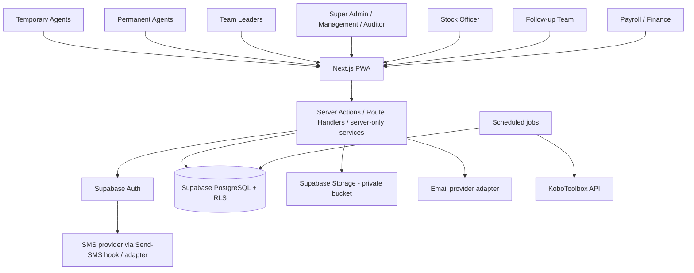
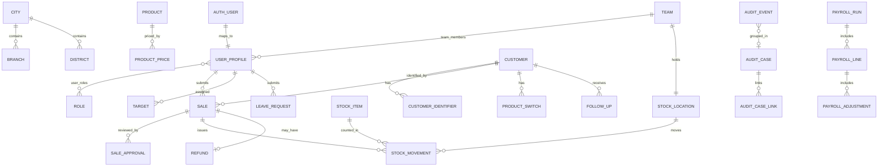
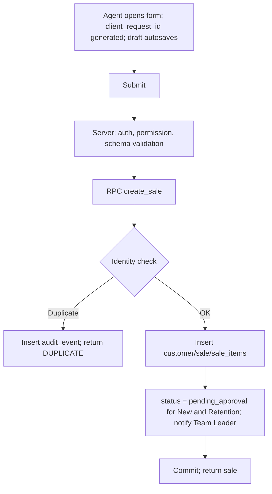
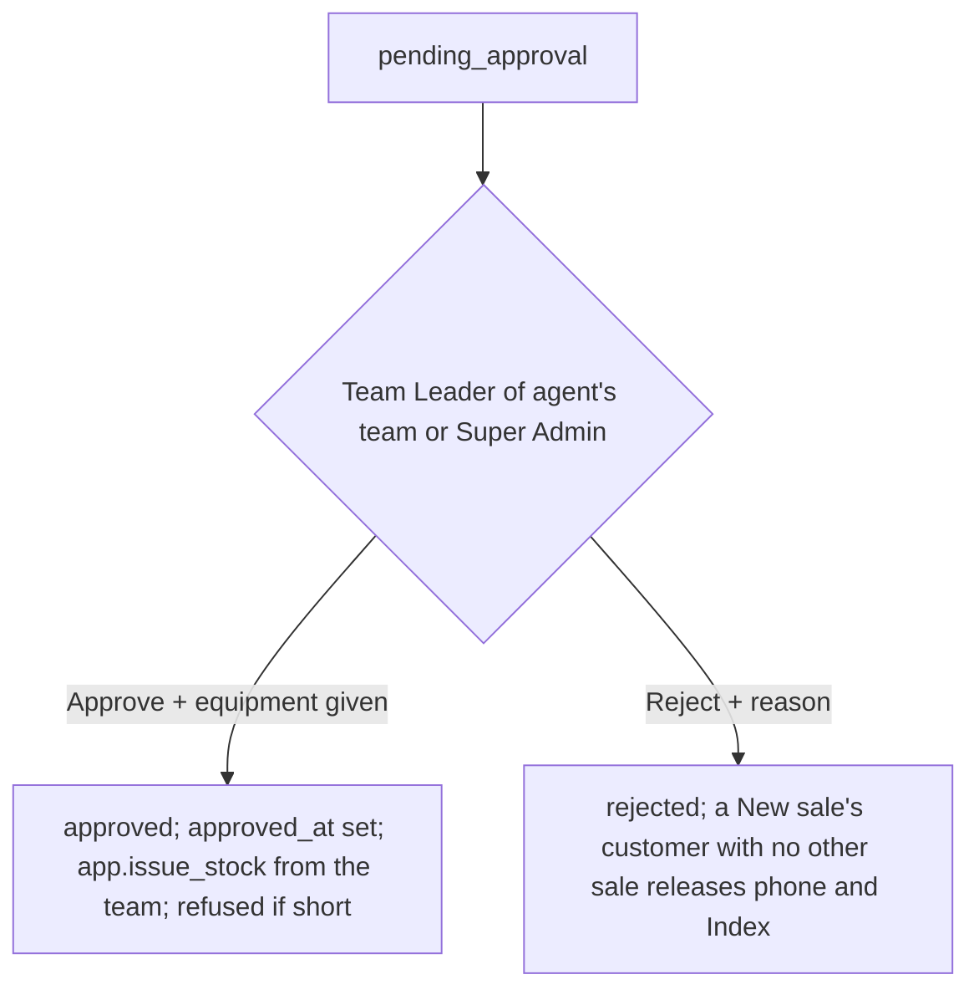
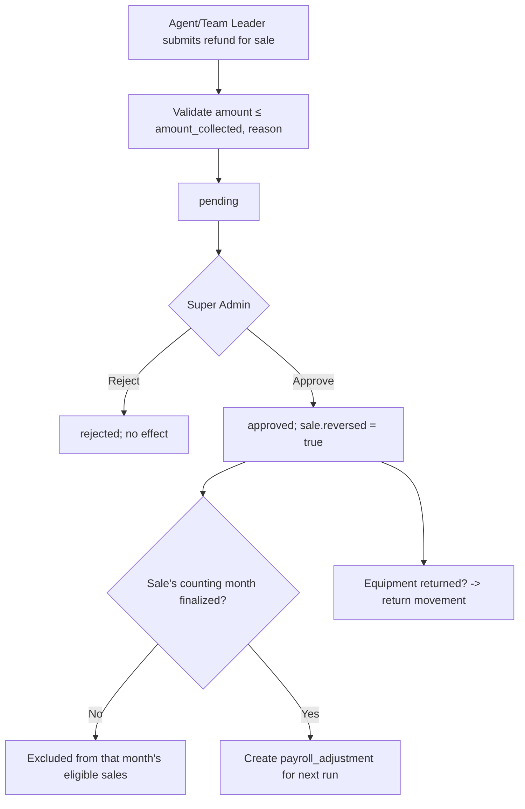

# Sogasho Outdoor Field Sales, Performance Analytics & Audit Control System
## System Design Document (SDD)

**Document version:** 1.5
**Status:** Approved design baseline. Items marked **OPEN** depend on the blocking inputs in BRD v1.5 §15.3.
**Business owner:** Sogasho ISP — Outdoor Sales / Commercial Department
**Technology baseline:** Next.js (TypeScript, installable PWA) + Supabase (PostgreSQL, Auth, Storage)
**Operating cities:** Hargeisa, Burco, Berbera, Borama (pilot: Hargeisa)

**Companion documents:**
- `Sogasho_Outdoor_Field_Sales_Audit_System_BRD_v1.5.md` — business source of truth
- `Sogasho_Outdoor_Field_Sales_Audit_System_Claude_Code_Roadmap_v1.5.md` — implementation sequence (Phases 0–20)

> **Document rule:** The BRD defines *what* the business needs. This SDD defines *how* the system is built. Business decisions are referenced by their BRD decision ID (D-01…D-30). Where an input is still OPEN, the design uses the provisional default and the affected phase cannot pass its acceptance gate until the input is recorded in `docs/implementation/DECISIONS.md`.

## Change history

| Version | Date | Summary |
|---|---|---|
| 1.0 | 18 Oct 2026 | Initial proposed technical design. |
| 1.1 | 19 Oct 2026 | Applied approved change proposal. Fixed companion filenames; aligned audit states with BRD; added identity & duplicate model, durable duplicate-attempt logging, idempotent submissions, stock custody and serial tracking, shared eligible-sale service, payroll cutoff/holds/adjustments, free-month handling, legacy import design, state machines, full permission matrix, environments & CI/CD, UI/brand/accessibility rules, PWA approach. Replaced the v1.0 SDD decision register with the BRD register (mapping in §28). Roadmap alignment updated to Phases 0–20. |
| 1.2 | 19 Oct 2026 | Applied business inputs of 19 Oct 2026 (BRD v1.5): Index Number = exactly 8 digits; products and prices maintained by Super Admin (no seed price list); 16 branches seeded; districts per city maintained by Super Admin; `areas` table removed (Area is free text); no legacy import (§19 retired, `import_batches` removed, opening stock via receipts); flat base salary from Settings with no pro-rating; recognition titles Best Agent / Hall of Fame / Champion based on consecutive months as #1, with frozen `monthly_rankings`; monthly performance bands (target 20, baseline 15). |
| 1.3 | 19 Oct 2026 | Stock item code `PDCOM` (D-10); SMS/OTP provider Telesom with a `telesom` adapter (D-20); sizing set to 46 agents (7 permanent, 39 temporary) with load test at 3× (D-28). Data-retention periods remain open. Telesom credentials held only in environment settings (no in-app configuration page for the pilot), §17.1. |
| 1.4 | 19 Oct 2026 | Sales-month control (D-30, Option A): `submitted_at` set only by the database clock; `sale_month` derived from it in EAT; RPC ignores client dates; previous-month draft warning; My Sales month selector with read-only past months (§22.4); finalized-month lock trigger on sales and related records. |
| 1.5 | 20–25 Oct 2026 | D-40 (25 Oct): Team Leaders approve their own sales (`app.check_decider`); own switches keep the no-self-approval rule (`app.check_switch_decider`, migration `20261025150000_team_leader_self_approval`). D-39 (25 Oct): `product_equipment` (allowed device per product) checked by `app.check_equipment` in approve_sale / approve_switch (migration `20261025120000_product_equipment`). D-38 (25 Oct) and Phase 8 (migration `20261025090000_approvals_switches`): approve_sale / reject_sale, releasable identifiers, product switches with approval, approvals history, notifications; §10.3, §10.4, §18 updated. D-37 (24 Oct): every sale pending until Team Leader / Supervisor approval; equipment recorded at approval (migration `20261024120000_sales_all_need_approval`); §10.2–10.3 updated. D-36 (24 Oct): close-match rule for Retention names, months paid 1–12, free month on any plan; Phase 7 built (migration `20261024090000_sales`, §10, §11.1). D-35 (22 Oct): stock by quantity, no serials; team stock with acceptance; returns by Stock Officer; §12 rewritten, stock tables updated (migration `20261022150000_stock`). D-32 (21 Oct): SMS OTP at sign-in for **every** user; `user_profiles.login_phone_e164` is every user's mobile number, unique per employment type; `admin_set_user_phone`, SQL-Editor-only `app.set_user_phone` (migration `20261021090000_otp_for_everyone`), §6.1 updated. D-31: no branch on users (column removed by migration `20261020190000_users_no_branch`); sale branch = money hand-in branch chosen per sale; stock locations Central Store → Team Leader/Supervisor → Agent (no branch stores). §8.3, §10.4, §12, §19 updated. Phase 4 authorization model as built: T-21…T-23. |

---

# 1. Purpose and audience

This document describes the architecture, application boundaries, data model, authorization model, workflows, integrations, quality controls and deployment approach.

Audience: Claude Code and developers implementing the system phase by phase; Super Admin and operational stakeholders; QA; the business owner.

The system is built in phases. This document is **not** authorization to build all modules at once. Implement only the phase currently approved in the Roadmap.

# 2. Design objectives

1. One traceable record of outdoor sales and customers.
2. Database-enforced uniqueness of customer phone and Index Number; stock balances never below zero.
3. Controlled approval of Retention sales and refunds.
4. Stock accountability by location and item (Central Store → team stock accepted by its Team Leader/Supervisor, D-31, D-35).
5. Follow-up tracking with Active / Expire / Not Reached.
6. Durable duplicate-attempt events and reviewable audit cases.
7. One shared **eligible-sale** definition used by targets, dashboard, payroll and rankings.
8. Authorization enforced on the server **and** by PostgreSQL Row Level Security (RLS).
9. Replaceable adapters for SMS/OTP, email and KoboToolbox; secrets server-side only.
10. Reliable use on phones with poor connectivity: draft autosave and idempotent submission.
11. A codebase delivered and verified one roadmap phase at a time.

# 3. System context



**Principle:** the browser is a presentation layer, never a trusted authority. Every privileged operation is validated on the server and protected at the database boundary.

| Actor / system | Responsibility |
|---|---|
| Temporary Agent | Phone + password + OTP login; register sales; hold stock custody; request leave |
| Permanent Agent | Email + password login; same operational functions |
| Team Leader | Approve team Retention; submit refunds; team views; city override |
| Super Admin | Users, teams, settings, prices, targets, refunds, audit cases, leave, fallback approver |
| Stock Officer | Receipts, transfers, returns, adjustment requests |
| Follow-up Team | Record follow-up outcomes |
| Finance | Payroll calculation, review, finalization, exports |
| Auditor / Management | Read-only reporting; assigned audit cases |
| SMS provider | OTP delivery only (D-23) |
| Email provider | Super Admin alerts |
| KoboToolbox | Survey submissions (one-way pull) |

# 4. Scope and module boundaries

Modules (with owning roadmap phase):

| # | Module | Phase |
|---|---|---|
| 1 | Application shell, brand/design system, CI, staging | 1 |
| 2 | Database foundation, activity log, audit event log | 2 |
| 3 | Authentication, sessions, OTP | 3 |
| 4 | Users, roles, permissions, teams | 4 |
| 5 | Master data and settings | 5 |
| 6 | Stock ledger and team custody (quantities, D-35) | 6 |
| 7 | Sales registration (New + Retention submission, free-month) | 7 |
| 8 | Retention approval, product switch | 8 |
| 9 | Duplicate detection, audit cases, alerts | 9 |
| 10 | Operational dashboard | 10 |
| 11 | Pilot readiness (Settings populated, opening stock received) | 11 |
| 12 | Refunds | 12 |
| 13 | Customer follow-up | 13 |
| 14 | Targets, KPIs and performance bands | 14 |
| 15 | Reports and exports | 15 |
| 16 | Payroll, incentives and monthly ranking freeze | 16 |
| 17 | Leave and private attachments | 17 |
| 18 | KoboToolbox integration | 18 |
| 19 | Performance recognition (Best Agent, Hall of Fame, Champion) | 19 |
| 20 | QA, security, UAT, production cutover | 20 |

## 4.1 Out of scope (BRD §3.2)

Core CRM/billing replacement; automated service-status checks; payment disbursement; native mobile apps; full offline operation; GPS/photo evidence (Release 2); ML fraud decisions; customer portal; Somali translation content in v1 (structure only).

# 5. Technology architecture

## 5.1 Baseline

| Layer | Technology | Notes |
|---|---|---|
| Web app | Next.js (App Router) + TypeScript strict | Server Components by default; client components only for interactivity |
| Styling | Tailwind CSS with Sogasho brand tokens | Tokens from `brand/colors/tailwind.colors.js`; see §22 |
| Components | Accessible headless primitives + project components | Keep dependencies minimal; justify each addition |
| Forms & validation | Shared schema validation (e.g., Zod) used on client and server | Server validation is authoritative |
| Auth | Supabase Auth (email+password, phone+password, phone OTP) | §6 |
| Database | Supabase PostgreSQL | Versioned migrations via Supabase CLI |
| Authorization | Server permission checks + RLS | §7 |
| Files | Supabase Storage, private bucket | Signed short-lived URLs |
| Jobs | Scheduled jobs (Supabase `pg_cron` or host cron calling a protected route) | Follow-up generation, Kobo sync, notification retries |
| i18n | Message files (`messages/en.json`), library chosen in Phase 1 | Somali added later without code changes (D-24) |
| PWA | Web app manifest + service worker caching the app shell only | No offline data sync (D-25) |
| Testing | Unit (Vitest or repo standard), DB tests (pgTAP / SQL tests), E2E (Playwright) | §25 |
| CI | GitHub Actions | §26 |
| Hosting | Selected in Phase 0 (recommended: Vercel or equivalent Node host; Supabase region chosen by latency test from Hargeisa) | |

## 5.2 Logical layers

```text
Presentation (Next.js pages/components, PWA shell)
        |
Server Actions / Route Handlers (thin: parse → authorize → call service)
        |
        +-- Session context (user, roles, permissions, scope, AAL)
        +-- Authorization policy (permission keys + scope)
        +-- Domain services: sales, customers, stock, approvals, refunds, switches,
        |   follow-up, audit, eligibility, reporting, payroll, leave, targets, recognition
        +-- Integration adapters: sms, email, kobo
        |
Database functions (RPC) for multi-step transactional operations
        |
Supabase PostgreSQL + RLS + private Storage
```

**Mutation pattern (single, consistent):** UI → Server Action → service → Postgres function (RPC) executed with the user's JWT so RLS applies. The service-role key is used only by server-side jobs and admin user creation, never in request paths that act on behalf of a normal user, and never in the browser.

## 5.3 Repository organization

```text
CLAUDE.md                     # standing rules for Claude Code
README.md
.env.example                  # names + placeholders only
brand/                        # Sogasho brand kit (source copy)
docs/
  00-source/                  # original requirements PDF
  01-business/                # BRD, glossary, sign-off log
  02-design/                  # SDD, data dictionary, ERD, permission matrix, state machines, wireframes
  03-implementation/          # ROADMAP.md, PHASE_LOG.md, DECISIONS.md
  04-quality/                 # test strategy, traceability matrix, UAT results
  05-security-privacy/        # threat model, data classification, retention policy
  06-operations/              # environments, backup/restore, incident runbook, support
data/
  master/                     # CSV seed for cities, branches and stock items (prices, districts, teams are entered by Super Admin)
messages/
  en.json
public/
  brand/                      # logos, icons, manifest icons
src/
  app/
    (auth)/  (app)/  api/
  components/   layout/ navigation/ forms/ tables/ feedback/ charts/
  features/     auth/ users/ settings/ stock/ sales/ retention/ product-switches/
                refunds/ follow-up/ audit/ dashboard/ reports/ targets/ payroll/
                leave/ performance/ integrations/
  lib/          supabase/ auth/ permissions/ validation/ errors/ logging/ i18n/ dates/ phone/
  server/       services/ repositories/ integrations/{sms,email,kobo}/ jobs/
supabase/
  migrations/
  tests/                      # RLS and constraint tests
  seed.sql                    # clearly labelled development data only
tests/
  unit/  e2e/
.github/workflows/ci.yml
```

Create folders only when the owning phase needs them.

# 6. Authentication and identity (D-20)

## 6.1 Flows

| User type | Sign-in | Account creation |
|---|---|---|
| Permanent | Email + password, then SMS OTP to the profile's mobile number (D-32) | Super Admin creates via server admin API with a mobile number; temporary password generated; `must_change_password = true` |
| Temporary agent | Phone (E.164) + password, then SMS OTP | Super Admin creates via admin API with phone marked confirmed; temporary password generated; `must_change_password = true` |

## 6.2 OTP design (spike required before Phase 3)

Preferred option: Supabase Auth MFA with **phone factor**; temporary agents must reach AAL2. Fallback option: application OTP (6 digits, hashed with a server secret, 5-minute expiry, single use) stored in `otp_challenges`, delivered through the SMS adapter. In both cases:

- SMS delivery goes through **Telesom** (D-20) via the Supabase Send-SMS hook or the server SMS adapter (`telesom` implementation of `SmsProvider`).
- Temporary-agent sessions without completed OTP can reach only the OTP screen. Middleware checks it; RLS helper `app.session_ok()` also requires `aal2` for temporary agents when OTP is enabled.
- Limits: 5 failed password attempts → 15-minute lockout (`auth_lockouts` table checked before calling Supabase); max 3 OTP sends per 15 minutes.
- OTP values are never logged or stored in plaintext.

The spike must demonstrate with the Telesom SMS API: phone+password sign-in, OTP delivery to Telesom numbers and to any other network the temporary agents use (e.g. Somtel), delivery latency, delivery reports and cost per SMS. If Telesom cannot deliver to other networks, report it so the business can require Telesom numbers for temporary agents. If neither option works securely, **stop and present options** — do not change the login policy silently.

## 6.3 Session rules

- Protected routes require a valid session; middleware refreshes cookies per the Supabase SSR pattern.
- `must_change_password` redirects to the change-password page until done.
- Deactivation: set `user_profiles.is_active = false`, ban the auth user, and revoke refresh tokens. RLS helper `app.is_active_user()` denies all data access for inactive users even if a token is still valid.
- No tokens, passwords or OTPs in logs.
- Sign-in errors are generic ("Phone/email or password is incorrect").

# 7. Authorization model (D-22)

## 7.1 Model

Tables: `roles`, `permissions`, `role_permissions`, `user_roles`, `teams`, `team_members`. Each permission has a key and a scope (`own`, `team`, `city`, `all`).

Permission keys:

```text
users.read users.manage users.disable teams.manage
settings.manage prices.manage
targets.read targets.manage
stock.read stock.receive stock.transfer stock.acknowledge stock.adjust.request stock.adjust.approve
sales.create sales.read sales.override_city
customers.read customers.change_identity
retention.review
switches.create
refunds.submit refunds.approve
followup.read followup.update
audit.read audit.manage
dashboard.read
reports.read reports.export
payroll.read payroll.calculate payroll.finalize
leave.request leave.review leave.assign
integrations.manage
performance.read
```

## 7.2 Default role mapping

| Permission | Agent | Team Leader | Follow-up | Stock Officer | Finance | Auditor/Mgmt | Super Admin |
|---|---|---|---|---|---|---|---|
| sales.create | own | own | – | – | – | – | all |
| sales.read | own | team | – | – | all | all | all |
| sales.override_city | – | team | – | – | – | – | all |
| customers.read (phone/Index) | own | team | due list | – | – | all | all |
| customers.change_identity | – | – | – | – | – | – | all |
| retention.review | – | team (not own) | – | – | – | – | all |
| switches.create | own | team | – | – | – | – | all |
| refunds.submit | own | team | – | – | – | – | all |
| refunds.approve | – | – | – | – | – | – | all |
| stock.read | own custody | team | – | all | all | all | all |
| stock.receive / transfer | – | – | – | all | – | – | all |
| stock.acknowledge | own | own | – | – | – | – | – |
| stock.adjust.approve | – | – | – | – | – | – | all |
| followup.update | – | – | all | – | – | – | all |
| audit.read / manage | – | – | – | – | – | read; manage if assigned | all |
| dashboard.read | own | team | – | stock widgets | all | all | all |
| reports.export | – | team | – | stock | payroll | all | all |
| payroll.read | own line | – | – | – | all | all | all |
| payroll.calculate / finalize | – | – | – | – | all | – | all |
| leave.request | own | own | own | own | own | own | – |
| leave.review / assign | – | – | – | – | – | – | all |
| targets.manage | – | – | – | – | – | – | all |
| settings.manage, users.manage | – | – | – | – | – | – | all |

Mapping is data, editable by Super Admin; the defaults above are seeded in Phase 4.

## 7.3 Enforcement layers

1. **UI:** navigation shows only permitted modules.
2. **Server:** every action calls `requirePermission(key, resource)`.
3. **Database:** RLS on every table in the exposed schema using helpers `app.has_permission(key)`, `app.in_scope(owner_id, team_id, city_id)`, `app.is_active_user()`.
4. **Storage:** private bucket; access only via server-issued signed URL after permission check.
5. **Audit:** sensitive decisions recorded in `activity_log`.

Hiding a button is never a security control. Tables without RLS policies are not exposed through the API.

# 8. Domain model and database design

## 8.1 Conventions

- Primary keys: `uuid` (`gen_random_uuid()`).
- Every table: `created_at timestamptz default now()`, `created_by uuid`, and where mutable `updated_at`, `updated_by`.
- Money: `numeric(12,2)` USD.
- Status fields: Postgres enums or `check` constraints, documented in the data dictionary.
- Timestamps stored UTC; business-month columns computed in EAT (UTC+3, IANA zone `Africa/Mogadishu`) via `app.business_month(ts)`.
- No hard deletes on business tables; `archived_at` for master data; reversal records for transactions.
- Append-only tables (`stock_movements`, `audit_events`, `activity_log`, `*_history`) have no UPDATE/DELETE grants for application roles.

## 8.2 Entity relationship overview



## 8.3 Core tables

| Table | Key columns / constraints | Phase |
|---|---|---|
| `user_profiles` | `id = auth.users.id`, full_name, employment_type (`temporary`/`permanent`), login_phone_e164, email, city_id (no branch — D-31; team via `team_members`), is_active, must_change_password, start_date, end_date | 3–4 |
| `roles`, `permissions`, `role_permissions`, `user_roles` | unique keys | 4 |
| `teams`, `team_members` | team_leader_id; agent belongs to one team | 4 |
| `cities`, `branches`, `districts` | active flag, unique names within parent city; branches seeded (§9); districts entered by Super Admin. No `areas` table — Area is free text on customers/sales | 5 |
| `customer_types` | `new`, `retention` (seeded, not editable codes) | 5 |
| `products` | code unique (`FTTA`,`FTTH`,`FTTB`,`LTE`), active | 5 |
| `plans` | product_id, name (unique per product), download_mbps, upload_mbps, data_allowance, active (D-34; 18 plans loaded) | 5 |
| `plan_prices` | plan_id, recharge_amount, installation_fee, effective_from, effective_to; same in all cities; overlapping ranges for the same plan refused (D-34; replaces `product_prices`) | 5 |
| `app_settings` | key/value: payroll_cutoff_day (3), incentive_threshold (15), incentive_rate (5), temp_base_salary (100, flat, edited by Super Admin), performance_target_units (20), performance_baseline_units (15), free_month_amount (50), allowed_phone_prefixes, week_start_day, weekend_days, otp_enabled | 5 |
| `public_holidays` | date, name | 5 |
| `stock_items` | code unique (`WIFI_ROUTER`,`PDCOM`,`CALIX`), display_name, is_serialized (always false, D-35) | 5 |
| `stock_locations` | kind (`central`,`faulty`,`team`), team_id (one stock per team, created with the team) — D-31, D-35 | 6 |
| `stock_adjustments` | location, item, quantity_change, reason, status (`requested`,`approved`,`rejected`), requested_by, decided_by, decision_note | 6 |
| `stock_movements` | append-only; movement_type (`receipt`,`transfer_out`,`transfer_in`,`issue`,`return`,`adjustment`), item_id, quantity, from_location_id, to_location_id, ref_type, ref_id, reason, actor_id, approved_by | 6 |
| `stock_transfers` | to_location (a team), status (`sent`,`accepted`,`cancelled`), note, sent_by, decided_by; lines in `stock_transfer_lines` (item, quantity) | 6 |
| `customers` | full_name, phone_e164, phone_display, index_number (check `^[0-9]{8}$`), district_id, area_text, city_id, branch_id | 7 |
| `customer_identifiers` | (`type` in `phone`,`index`), value, customer_id, is_current; **unique(type, value)** — covers current and historical values (reservation, D-01) | 7 |
| `sales` | customer_id, agent_id, product_id, plan_id, plan_price_id, unit_price (recharge snapshot), installation_fee (snapshot), months_paid, amount_collected, free_month bool, customer_type, city_id, branch_id (money hand-in branch, chosen per sale — D-31), district_id, area_text, status, submitted_at (database `now()` only — never from the client, D-30), approved_at, sale_month (generated from submitted_at in EAT), client_request_id **unique** (idempotency) | 7 |
| — | partial unique index `(customer_id, sale_month)` where status in (`approved`,`pending_approval`) → one active sale per customer per month (D-01) | 7 |
| `sale_items` | sale_id, stock_item_id, quantity (D-35: no serial) | 7 |
| `sale_approvals` | sale_id, decision, reason, decided_by, decided_at (append-only) | 8 |
| `product_switches` | customer_id, from_product_id, to_product_id (check from ≠ to, both in FTTA/FTTH), equipment issued (item, quantity), actor | 8 |
| `audit_events` | rule_code, severity, attempted_values jsonb (masked where needed), matched_customer_id, actor_id, context, created_at; append-only | 2 (table), 7 (duplicate events) |
| `audit_rules` | code, description, enabled | 9 |
| `audit_cases` | state, assigned_to, opened_at, closed_at, disposition | 9 |
| `audit_case_links` | case_id, entity_type, entity_id | 9 |
| `audit_case_history` | case_id, from_state, to_state, note, actor (append-only) | 9 |
| `notifications` | recipient_id, type, title, link, read_at | 8–9 |
| `activity_log` | actor_id, action, entity_type, entity_id, before/after (safe subset), created_at; append-only | 2 |
| `refunds` | sale_id unique (one refund per sale), amount (check > 0 and ≤ sale.amount_collected), reason, note, status, requested_by, decided_by, decided_at, payroll_adjustment_id | 12 |
| `follow_ups` | customer_id, sale_id, due_month, outcome (`active`,`expire`,`not_reached` or null), completed_by, completed_at, notes; **unique(customer_id, due_month)** | 13 |
| `targets` | scope (`agent`,`team`,`city`), scope_id, period_start, period_end, kpi (`units`,`revenue`,`retention_units`…), target_value | 14 |
| `export_log` | user, report, filters jsonb, format, row_count, created_at | 15 |
| `payroll_runs` | month unique, status (`draft`,`calculated`,`finalized`), cutoff_at, rule_version, calculated_by, finalized_by, finalized_at | 16 |
| `payroll_lines` | run_id, agent_id, city, units per product, new_count, retention_count, revenue, base_salary, incentive, adjustments_total, gross_pay, on_hold, mismatch, snapshot jsonb (sale IDs, settings used) | 16 |
| `payroll_adjustments` | line_id, source_type (`refund`,`audit`,`manual`), source_id, original_run_id, amount, units_delta, reason | 16 |
| `leave_entitlements` | user_id, year, annual_days | 17 |
| `leave_requests` | user_id, department, leave_type, start_date, end_date, working_days, reason, status, decided_by, attachment_id | 17 |
| `private_attachments` | bucket, path, owner_entity, mime, size, uploaded_by | 17 |
| `monthly_rankings` | month, agent_id, rank, eligible_units, eligible_revenue, band (`target_met`,`baseline`,`underperforming`), is_best_agent, streak_months, title (`best_agent`,`hall_of_fame`,`champion` or null); **unique(month, agent_id)**; written when the month's payroll run is finalized, then immutable | 16 (write), 19 (display) |
| `survey_forms`, `survey_submissions` | form_uid; **unique(form_uid, kobo_submission_uuid)**, submitted_at, mapped fields jsonb, raw_ref, sync_run_id | 18 |
| `integration_runs` | provider, operation, status, started/finished, safe_error, counts | 17–18 |

Create each table in the phase that owns it, with its RLS policies and tests.

## 8.4 Integrity rules

- Phone and Index uniqueness enforced by `customer_identifiers` unique index; old values stay reserved.
- Stock: deductions lock (location, item) and refuse to go below zero (D-35).
- Sale + sale_items + stock movements in one transaction (RPC).
- Stock balance derived from `stock_movements` (quantities, D-35); no editable balance column.
- Refunds never delete sales; they set the sale's `reversed` flag through the refund approval function.
- Payroll lines of a finalized run are immutable (trigger rejects UPDATE when run is finalized).
- **Finalized-month lock (D-30):** a trigger rejects INSERT/UPDATE on `sales`, `sale_items` and `sale_approvals` for sales whose counting month belongs to a finalized payroll run; later corrections go through `payroll_adjustments` in the next run. Not locked: refunds (approval after finalization creates an adjustment, D-15), follow-ups (recorded in the month after the sale, D-17), audit cases and stock returns.
- Audit events and activity log: insert-only.

# 9. Master data and configuration

- Cities seeded: Hargeisa, Burco, Berbera, Borama.
- Branches seeded from `data/master/branches.csv` (D-29, BRD §6.2.1): Hargeisa — HQ, JJ Yar, Idaacadda, MSG, Boqol Jire, Xero-Awr, Guuled, Adna, Isha Borama, Star, New Hargeisa; Burco — Burco Deero, Burco Plaza; Borama — Shacabka, Suuqa; Berbera — Xarunta Dhexe. Super Admin can add, rename and deactivate.
- Districts: entered per city by Super Admin in Settings (no seed). Area: free text on the sales form, trimmed, max 100 characters; no managed list.
- Teams: created by Super Admin in Settings (Phase 4).
- Products seeded: FTTA, FTTH, FTTB, LTE, each with **plans** (D-34). The owner's 18 plans and their recharge / installation prices are loaded (BRD §6.3.1), effective 22 Oct 2026; Super Admin maintains them on the Products screen. Pilot readiness (Phase 11) checks that every active plan has a current price.
- Performance settings: target 20 and baseline 15 eligible units per month, editable by Super Admin.
- Base salary for temporary agents: one flat amount (currently $100), editable by Super Admin (D-08).
- Stock items seeded: WiFi Router, PDCOM, CALIX, counted by quantity (D-35). Spelling "PDCOM" confirmed (D-10).
- Deactivated values remain readable on history and are rejected for new records.
- All changes recorded in `activity_log`.
- Phone prefixes (`allowed_phone_prefixes`) configurable; initial value 063 and 065 (D-33). Business week starts Saturday (`week_start_day`, D-33); weekend Friday (D-18).
- As built in Phase 5 (migration `20261022090000_master_data`): writes only through SECURITY DEFINER functions (`admin_set_setting` with per-key validation and baseline < target, `admin_save_branch`, `admin_save_district`, `admin_rename_customer_type`, `admin_save_product`, `admin_save_plan`, `admin_save_plan_price` (D-34, migration `20261022120000_plans`), `admin_save_stock_item`, `admin_save_holiday`, `admin_delete_holiday`); price overlap refused by a trigger (same plan); `public.plan_price(plan, date)` returns the recharge and installation fee in force.

# 10. Sales and customer lifecycle

## 10.1 Identity resolution (D-01, D-03)

Normalization: strip spaces/dashes; accept `+252XXXXXXXXX`, `252…`, `0…`, or local digits; produce E.164; reject if prefix not allowed. Index: the customer's service account number (D-02); trim spaces, then require exactly 8 digits (`^[0-9]{8}$`, e.g. `50091293`), enforced in the shared schema and by a database check constraint.

```text
lookup phone_owner = customer_identifiers(phone, value)
lookup index_owner = customer_identifiers(index, value)

if customer_type = NEW:
    if phone_owner or index_owner exists -> DUPLICATE_ATTEMPT (blocked)
    else create customer

if customer_type = RETENTION:
    if neither exists -> create customer (source=field), continue
    if both exist and same customer and name matches (normalized, fuzzy threshold) -> link
    if only one exists and it is the same customer's other identifier missing -> link and add identifier
    if phone_owner != index_owner, or name materially differs -> DUPLICATE_ATTEMPT (blocked)

then: one active sale per customer per sale_month (partial unique index)
```

Name comparison rule (D-36, `app.names_match`): names are lower-cased and stripped of everything but letters; they match when equal, equal without spaces ("Abdi Rahman" = "Abdirahman"), equal with words in any order, or within an edit distance of 1 per 5 letters (minimum 1: "Mohamed" ≈ "Mohammed"). Tested in `tests/db/sales.test.ts`.

As built (Phase 7): a Retention where only one number is known links the customer only if the customer's other number is not yet recorded; a former (replaced) number is refused (`IDENTITY_CONFLICT`, field `former_number`).

## 10.2 New sale flow (including free-month, D-09)



- Price: server selects the `plan_prices` row in force for the chosen plan at submission (D-34); client-sent price is ignored.
- Months paid 1–12 (D-36): `amount_collected = unit_price × months_paid + installation_fee` (database check constraint).
- Free-month option (D-36): `free_month = true` when the agent selects "Pay 2 months, get 1 free" — any plan; `months_paid` is 2 and `2 × unit_price` must be at least `app_settings.free_month_amount` (default $50); counts as 1 unit.
- `agent_id` always from the session.
- **Sale date and month (D-30):** the form has no date field. `submitted_at` is set by the database (`default now()`, column not writable by application roles); `sale_month = app.business_month(submitted_at)`. Any date in the request payload is ignored. The device clock is never used. Option A: no feature exists to move a sale to another month.

## 10.3 Sale approval (D-14, D-37)



- Reviewer cannot be the submitting agent (check in RPC and RLS).
- As built (Phase 8): `approve_sale(id, items)` / `reject_sale(id, reason)`; `app.check_decider`: `retention.review` permission, leader of the sale's team or Super Admin; never approves one's own — except a Team Leader's own SALE, which they may approve from their team's stock (D-40); a Super Admin may reject (cancel) their own. Switches: nobody decides their own (`app.check_switch_decider`); history in `approvals`. Rejecting a New sale releases the customer's identifiers (`released_at`) when the customer has no other sale or switch; released numbers may be registered again; replaced numbers stay reserved.
- Equipment rule (D-39): `product_equipment` lists the devices allowed per product (FTTA → WiFi Router; FTTH, FTTB → PDCOM or CALIX; LTE → none). A product with rows needs exactly one of them (quantity 1) at approval; a product without rows takes none (`EQUIPMENT_REQUIRED`, `EQUIPMENT_ONE`, `EQUIPMENT_NOT_ALLOWED`). Switches use the new product.
- Applies to every sale, New and Retention (D-37). Equipment is chosen by the approver and deducted at approval (`sale_items` written then); nothing moves at submission. The approver cannot change the sale — approve or reject only.
- Approval time drives the payroll counting month (§14.1).

## 10.4 Product switch (D-16)

- Allowed only FTTA ↔ FTTH; check constraint `from_product_id <> to_product_id`.
- Name (close match, D-36), current phone and current Index must match one existing customer; From Product must be `app.current_product` (latest approved sale or switch); otherwise `SWITCH_MISMATCH` audit event and a mismatch result (UAT-12).
- `create_switch` saves it as pending (one pending switch per customer; agent picks the new plan; no payment — D-38). `approve_switch(id, items)` by the Team Leader / Supervisor (Super Admin fallback; never one's own) issues the new equipment from the switch's team stock; `reject_switch(id, reason)`. The old equipment is returned via the Stock Officer (D-35). Super Admins do not register switches.
- Never creates a sale; excluded from all unit/revenue metrics.

## 10.5 Refund (D-15)



## 10.6 Idempotency and poor connectivity (D-25)

- Each form instance has a `client_request_id` (UUID) stored with the draft.
- `sales.client_request_id` is unique; a retry returns the existing sale instead of creating another.
- Same pattern for switches, refunds, stock transfers and acknowledgements.
- Drafts stored on the device (IndexedDB/localStorage) and cleared after confirmed success; no customer data is cached beyond the draft.
- Each draft stores the month (EAT) it was started in. If a draft from an earlier month is opened or submitted, the form shows: "This sale will be recorded in {current month}" before the agent confirms (D-30). The sale still uses server time.

# 11. Duplicate detection and audit design (D-13)

## 11.1 Durable duplicate-attempt logging

A rejected submission must still leave an audit event. Design:

- `create_sale` is a PL/pgSQL function. Identity pre-checks run first; on duplicate it **inserts the audit event and returns a structured result** (`{status: 'duplicate', field, matched_customer_id}`) instead of raising, so the event commits.
- Race condition: the customer/sale insert runs inside a nested `BEGIN … EXCEPTION WHEN unique_violation` block; on violation the inner block rolls back, the function then inserts the audit event and returns `duplicate`.
- The server action maps the result to a user-facing message and triggers the Super Admin notification (§18).

## 11.2 Rules

| Code | Rule | Phase | Default |
|---|---|---|---|
| DUP_PHONE | New sale with existing phone | 7 | on |
| DUP_INDEX | New sale with existing Index | 7 | on |
| IDENTITY_CONFLICT | Retention with phone/Index of different customers or name mismatch | 7 | on |
| SAME_MONTH | Second active sale for customer in month | 7 | on |
| SWITCH_MISMATCH | Switch identity mismatch | 8 | on |
| MULTI_AGENT_ATTEMPT | Same identifier attempted by ≥ 2 agents in 30 days | 9 | off until pilot review |
| BURST | ≥ N sales by one agent in M minutes | 9 | off |
| POST_APPROVAL_EDIT | Change to a sale after approval | 9 | on |
| HIGH_REFUND_RATE | Agent refund rate above threshold | 12 | off |
| FOLLOWUP_SKEW | Follow-up outcomes concentrated for one agent | 13 | off |

Rule thresholds live in `audit_rules`; enabling a rule is a Super Admin action (logged).

## 11.3 Case lifecycle

```text
Open → Under Review → Confirmed Issue → Resolved
                    ↘ False Positive  → Resolved
```

- Events can be grouped into a case automatically (same identifier within 30 days) or manually.
- Only Super Admin or the assigned Auditor changes state; each change writes `audit_case_history` with a note.
- Effects: Open/Under Review → linked agents' payroll lines **on hold**; Confirmed Issue → linked sales ineligible; False Positive → no effect.
- No user can edit or delete events, cases or history.

# 12. Stock management design (D-10, D-31, D-35)

D-35 (owner, 22 Oct 2026) replaces serial tracking: stock is counted by **quantity** per item (WiFi Router, PDCOM, CALIX). Built in Phase 6 (migration `20261022150000_stock`).

## 12.1 Locations and custody

```text
Central Store (Stock Officer)          Central Store — faulty
   └─ send → team stock (in transit until the Team Leader / Supervisor — or Super Admin — accepts)
                 └─ issue → customer (sale / switch by any member or the leader of the team)
Returns (Stock Officer only): team or customer → Central Store, or → faulty store; reason required
Agents hold no stock of their own; branches hold no Outdoor stock (D-31)
```

## 12.2 Operations (database functions; each checks its permission)

| Operation | Who | Function | Effect |
|---|---|---|---|
| Receive | Stock Officer (`stock.receive`) | `stock_receive(lines, note)` | `receipt` movements into Central |
| Send | Stock Officer (`stock.transfer`) | `stock_send(team, lines, note)` | `stock_transfers` (sent) + `transfer_out` from Central; not yet counted for the team |
| Accept | The team's Team Leader / Supervisor (`stock.acknowledge`) or Super Admin | `stock_accept(transfer)` | `transfer_in` to the team; status accepted |
| Cancel | Stock Officer, before acceptance, with reason | `stock_cancel(transfer, reason)` | `transfer_in` back to Central; status cancelled |
| Issue | Sale / switch (internal, Phases 7–8) | `app.issue_stock(seller, lines, ref)` | `issue` from the seller's team stock; refused when short or the seller has no team |
| Return | Stock Officer only (`stock.transfer`) | `stock_return(team or null, item, qty, reason, note, faulty)` | `return` to Central or the faulty store; reasons faulty / refund / switch / retention_rejected / other |
| Adjustment | Requested by Stock Officer, approved by Super Admin (never by the requester) | `stock_request_adjustment`, `stock_decide_adjustment` | `adjustment` movement on approval |

## 12.3 Balance and reconciliation

```text
Location closing = opening + received + transferred in − transferred out − issued + returned in − returned out ± adjustments
```

Balances are computed from the append-only `stock_movements` ledger (no balance column). `stock_report(from, to)` returns these columns per location and item, plus stock in transit to each team; RLS limits it to the locations the caller may see (all for Stock Officer / Finance / Auditor / Super Admin; their own team for Team Leaders and agents). There is no legacy import (D-21): opening stock is recorded as ordinary receipts before go-live.

## 12.4 Concurrency

Every decrease takes a transaction-level advisory lock on (location, item) and re-reads the balance before writing, so two deductions cannot overdraw the same stock; a short balance aborts the whole transaction (all lines or none).

# 13. Customer follow-up design (D-17)

- A scheduled job on the 1st of each month (EAT) inserts one `follow_ups` row per customer with an approved sale in the previous month. `unique(customer_id, due_month)` makes the job safe to re-run.
- Follow-up users see only: name, Index, phone, branch, city, customer type, outcome.
- Outcomes: `active`, `expire`, `not_reached`. `Not Reviewed` = outcome null after the due month ends (derived, not stored); shown on the overdue list.
- Completion stores user and time; changes after completion are logged.
- Follow-up status is separate from sale status.

# 14. Eligibility, dashboard, reporting, targets and recognition

## 14.1 Shared eligibility service (D-06)

One database view/function `app.eligible_sales(month)` used by **every** consumer. A sale is included when:

```text
status = 'approved'
AND NOT reversed (approved refund)        -- finalized runs use snapshots, see §15
AND NOT linked to audit case in 'confirmed_issue'
AND record is a sale (switches live in another table)
AND counting_month = month
where counting_month =
    sale_month                if approved_at <= payroll_cutoff(sale_month)
    business_month(approved_at) otherwise
payroll_cutoff(m) = (m + 1 month) + (payroll_cutoff_day − 1) days, end of day EAT
```

It also returns `on_hold` = linked to an Open/Under Review case. Unit tests and SQL fixture tests cover each condition. Dashboards label figures **Submitted** (all non-rejected) or **Eligible**.

## 14.2 Dashboard (Phase 10)

Metrics per BRD §9.1. Server-side aggregation (SQL functions) only; no fetching all sales to the browser. Filters: period, city, branch, product, agent (within scope). Each widget shows its definition and freshness time. Charts use the categorical palette in §22.

## 14.3 Reports and exports (Phase 15, D-26)

- Reports per BRD §9.2 with filters city, branch, product, price, agent, status and period (week, month, quarter, six months, year; week start day from settings).
- Exports: CSV and XLSX (reports); PDF (payroll summary, payslip). Generated server-side, streamed, with generated-at time and filters in the header.
- Columns limited to what the user may see; phone/Index masked unless the role permits.
- Every export inserted into `export_log`.
- Dashboard and report use the same SQL functions so equal filters give equal totals (tested).

## 14.4 Recognition (Phase 19, D-19)

- Rank agents by eligible units for the selected month; tie-break by eligible revenue, then earliest `approved_at` of the agent's last counted unit; exclude agents with a Confirmed Issue case that month.
- Titles (D-19), computed from frozen `monthly_rankings`:

```text
is_best_agent(m)  = rank(m) = 1
streak(m)         = is_best_agent(m) ? streak(m-1) + 1 : 0      -- months before the first frozen month count as 0
title(m)          = streak(m) >= 4 ? 'champion'
                  : streak(m) = 3 ? 'hall_of_fame'
                  : streak(m) >= 1 ? 'best_agent'
                  : null
```

  Champion replaces Hall of Fame for that agent; a month not ranked #1 resets the streak to 0.
- `monthly_rankings` rows are written in the same transaction that finalizes the month's payroll run, so titles never change after the fact. The current, not-yet-finalized month is shown as a live "provisional" leaderboard without titles beyond Best Agent (provisional).
- Top product and top branch by eligible units (tie: revenue).

## 14.5 Targets and performance bands (Phase 14)

- Targets stored separately (`targets`); achievement computed from `app.eligible_sales` for the target period and scope.
- Displays target, achieved, remaining and % attained; zero targets display "no target set".
- **Performance band** per agent per month from eligible units and settings: `units >= performance_target_units (20)` → Target met; `units >= performance_baseline_units (15)` → Baseline; otherwise → Underperforming. Implemented as one pure, unit-tested function used by the agent view, Team Leader view, dashboard and agent performance report; stored in `monthly_rankings.band` when the month is frozen.

# 15. Payroll and incentive design

## 15.1 Rules (BRD §8)

```text
units           = count(eligible sales for agent, month)   -- by product → FTTA/FTTH/FTTB/LTE
grand_total     = FTTA + FTTH + FTTB + LTE
mismatch        = (new_count + retention_count) <> grand_total
incentive       = max(0, units - incentive_threshold) * incentive_rate   -- 15, $5 (D-07)
base_salary     = temporary AND active at any time in month ? temp_base_salary : 0   -- D-05, D-08 (flat, no pro-rating)
adjustments     = sum(payroll_adjustments for this line)
gross_pay       = base_salary + incentive + adjustments
```

`temp_base_salary` is read from `app_settings` at calculation time (currently $100) and stored in the line snapshot; changing the setting never alters a finalized run. Start date, end date and leave do not change the base.

## 15.2 Run lifecycle

```text
draft → calculated → finalized
          ↑    |
          └────┘ (recalculate allowed until finalized)
```

1. Finance creates the run for month M after the cutoff.
2. Calculate: for each active-in-month agent, read `app.eligible_sales(M)`, compute line, set `on_hold`, `mismatch`; collect adjustments (refunds approved after earlier runs were finalized; Confirmed Issue findings on previously paid sales).
3. Review: drill-down from every number to the sales.
4. Finalize: allowed only when no line is on hold or mismatched (or the line is explicitly excluded and carried to next run, logged). Stores the snapshot (sale IDs, settings, rule version) and writes the month's `monthly_rankings` (rank, band, streak, title); run becomes immutable.
5. Exports: XLSX, PDF summary, PDF payslip per agent.

## 15.3 Required boundary tests

| Units | Incentive |
|---:|---:|
| 0 | $0 |
| 1 | $0 |
| 14 | $0 |
| 15 | $0 |
| 16 | $5 |
| 17 | $10 |
| 20 | $25 |
| 30 | $75 |

Plus: mismatch blocks finalization; hold blocks finalization; refund before/after finalization; Retention approved before/after cutoff; temporary agent starting or leaving mid-month still gets the full base; base-salary setting changed after finalization leaves the finalized run unchanged; recalculation reproduces the snapshot; `monthly_rankings` written once at finalization.

# 16. Leave management and file storage (D-18)

- Agents submit requests; Super Admin approves/rejects and sets annual entitlements.
- `working_days` computed server-side: days in range excluding `weekend_days` (default Friday) and `public_holidays`.
- Validation: end ≥ start; days > 0; annual requests within remaining entitlement (warning, Super Admin may override with reason).
- Attachments: private bucket `leave-attachments`; PDF/JPG/PNG; max 5 MB; MIME and extension checked; path `leave/{request_id}/{uuid}`; download only via signed URL valid ≤ 5 minutes after permission check. No public URLs.
- Leave never changes payroll base (D-08).

# 17. Integration design

## 17.1 SMS / OTP (Phase 3, D-20)

Interface:

```ts
interface SmsProvider {
  sendOtp(phoneE164: string, code: string): Promise<{ providerMessageId: string }>;
}
```

- Implementations: `test` (writes to a dev-only log table, never in production) and `telesom` (D-20). Telesom API URL, credentials and sender name are environment variables; values supplied by IT.
- **Credentials (pilot decision):** held only in server environment settings, never in the database, the repository or any app screen. Variable names (values never written down in docs or chat):

  | Variable | Purpose |
  |---|---|
  | `TELESOM_USERNAME` | Telesom SMS account username |
  | `TELESOM_PASSWORD` | Telesom SMS account password |
  | `TELESOM_API_KEY` | Telesom SMS API key |
  | `TELESOM_SENDER` | Sender name shown on the SMS (`SOGASHO`) |
  | `TELESOM_API_URL` | Telesom SMS endpoint (from Telesom documentation) |

  Set them with `supabase secrets set` if the sender runs in Supabase (Send-SMS hook / Edge Function), or in the web host's environment settings if it runs in the Next.js server; Phase 3 picks one. Staging and production are set separately. Which of username/password/API key Telesom actually requires is confirmed in the SMS test (R-6); unused variables are removed. Credentials are rotated if ever exposed and at least yearly; the adapter never logs them.
- If Supabase phone MFA is used, the Supabase Send-SMS hook calls this adapter.
- Timeouts 10 s; no automatic resend (user-initiated, rate-limited).
- `integration_runs` records outcome without the code.

## 17.2 KoboToolbox (Phase 18, D-27)

- One-way pull from the KoboToolbox API (v2 asset data endpoint) using a server-side API token.
- Hourly scheduled job + "Sync now" button (`integrations.manage`).
- Incremental by last submission time; pagination; schema validation per configured form mapping.
- `unique(form_uid, kobo_submission_uuid)` prevents duplicates; edited submissions update the stored mapped fields and keep a version note.
- Errors recorded per submission in `integration_runs` (safe error details, failed submission IDs); survey data never writes to customers or sales.
- **Form IDs and mappings OPEN.**

## 17.3 Email

Transactional email provider selected in Phase 0. Messages contain no phone/Index — only a link to the authenticated case/notification.

## 17.4 Failure handling

Timeouts, bounded retries only for idempotent calls, safe error summaries, visible status, documented manual recovery path. No tokens, OTPs or customer identifiers in logs.

# 18. Notifications (D-23)

| Event | Recipient | Channel |
|---|---|---|
| Duplicate attempt / new audit case | Super Admin | In-app + email |
| Case assigned | Assigned Auditor | In-app + email |
| Sale or switch awaiting decision | Agent's Team Leader (Super Admin when the seller has no team leader or is the leader) | In-app (built Phase 8) |
| Sale or switch approved / rejected (with reason) | Agent | In-app (built Phase 8) |
| Refund awaiting approval | Super Admin | In-app |
| Stock issued, awaiting acceptance | Receiving Outdoor Supervisor | In-app (built Phase 8) |
| Integration failure | Super Admin | In-app + email |
| OTP | Every user at sign-in (D-32) | SMS |

Notifications are rows in `notifications`; email sending is retried by a job; failures logged.

# 19. Go-live data (Phase 11, D-21)

The v1.1 legacy import design is **retired**: Sogasho starts the system as brand new.

- No customer import. Customers are created only through sales registration; earlier Sogasho customers are registered on their first visit (normally as Retention, which requires approval).
- Opening stock: the Stock Officer records every unit on hand as a `receipt` into Central Store (quantities), then sends to teams, whose Team Leaders accept (D-35).
- Settings populated by Super Admin before go-live: prices for every active product, districts for the pilot city, teams, users, base salary, performance target/baseline.
- Pilot readiness check (automated where possible): every active product has an active price; every agent has a city, a team and a custody location; Central Store stock count agrees with the Stock Officer's physical count.
- Fraud consideration: with no prior customer list, a returning customer could be registered as New. Mitigations: Retention approval, MULTI_AGENT_ATTEMPT rule, New/Retention mix by agent on the dashboard, Team Leader spot checks of Index Numbers against service status.

# 20. State machines

| Entity | States and transitions |
|---|---|
| Sale | `pending_approval` (Retention) → `approved` / `rejected`; New: created as `approved`; `approved` → `reversed` (refund approved) |
| Refund | `pending` → `approved` / `rejected` |
| Product switch | `completed` (single atomic step) |
| Stock transfer | `sent` → `accepted` or `cancelled` (D-35) |
| Stock transfer | `sent` → `acknowledged` / `cancelled` |
| Audit case | `open` → `under_review` → `confirmed_issue` / `false_positive` → `resolved` |
| Follow-up | `due` (outcome null) → `active` / `expire` / `not_reached`; derived `not_reviewed` after due month |
| Payroll run | `draft` → `calculated` ↔ (recalculate) → `finalized` |
| Payroll line | `ok` / `on_hold` / `mismatch` → `ok` when resolved |
| Leave request | `pending` → `approved` / `rejected`; `approved` → `cancelled` (Super Admin, before start date) |
| User | `active` ↔ `inactive` |

Transitions are enforced in database functions; invalid transitions raise a typed error. Tests cover each allowed and forbidden transition.

# 21. Error handling and validation

## 21.1 Shared validation

Required fields; phone normalization and prefixes; Index format (configurable); master data active; positive quantities; money ≤ limits; date ranges; payroll period; permission and scope; state transitions. Database constraints back up every critical rule.

## 21.2 Error categories

| Code | Meaning | User message style |
|---|---|---|
| `VALIDATION` | Input invalid | Field-level, how to fix |
| `DUPLICATE` | Identity/same-month conflict | Which field conflicts; no other customer's personal data shown to agents |
| `FORBIDDEN` | Not permitted | "You don't have access to this action" |
| `CONFLICT` | State changed (e.g., already approved) | Refresh prompt |
| `INTEGRATION` | External service failed | Retry later / contact admin |
| `UNEXPECTED` | Anything else | Generic with reference ID |

No stack traces, SQL or secrets in responses. Server logs strip phone, Index, tokens and OTPs.

# 22. UI, brand and accessibility

Source: `brand/` (Sogasho brand kit, *SO! Brand Style Guide 2013 v1.1*).

## 22.1 Logo

- Logo on **white or pure black only**. Layout: white top bar with `so-logo-primary.svg` (40–48 px high); sidebar white, or black with `so-logo-reverse.svg`; collapsed nav uses `so-mark.svg` (≥ 30 px).
- Keep 1.5x clear space; never stretch, recolour or rotate.
- Favicon `so-icon-32.png`; PWA icons 192/512; Apple touch 180. Produce in Phase 1: `favicon.ico`, maskable 512 icon, report/payslip letterhead.

## 22.2 Colour (WCAG 2.1 AA)

| Use | Token | Hex | Rule |
|---|---|---|---|
| Body text | `--so-text` | #293033 | |
| Secondary text | `--so-text-muted` | #545A60 | |
| Links, text-on-white accents | `--so-brand-primary-dark` | #00557C | Use for all small coloured text |
| Primary buttons, large text, highlights | `--so-brand-primary` | #0095A9 | ≈3.6:1 on white → not for small text; white button text must be ≥ 18.66 px bold or use #00557C button |
| Accent / CTA | `--so-brand-accent` | #E55E32 | Large text / backgrounds only |
| Borders | `--so-border` | #CFD8DD | |
| Page background | `--so-surface` | #E2E8ED | Cards white |
| Tagline blue | #143885 | Logo tagline only — never UI |
| Lavender family | — | — | **Not used** (source values corrupt) |

Status badges (background colour + dark or white text chosen to meet 4.5:1, always with a text label, never colour alone):

| Status | Colour token |
|---|---|
| Pending | orange-300 #F3A843 (dark text) |
| Approved | green-500 #0095A9 |
| Rejected | orange-700 #D83331 |
| Flagged / Under Review | purple-500 #824B94 |
| Refunded / Reversed | gray-500 #8D939E |
| Active | green-300 #03B7B8 (dark text) |
| Expire | pink-500 #B22662 |
| On hold | orange-500 #E55E32 |

Charts: categorical order green-500, orange-500, blue-500, pink-500, purple-500, gray-500; verify contrast against white and add direct labels.

## 22.3 Typography

Signika, self-hosted WOFF2 (300/400/600/700) loaded locally (no external font CDN, for speed on mobile networks). Body Regular 14–16 px; tables 14 px; section titles Semibold 20–24 px; page titles Semibold 28–32 px. **Titles lowercase** per brand guide — applied to page and section titles only, never to customer names, data, buttons or form labels.

## 22.4 Layout and usability

- Mobile-first for agent screens (sales form, custody, own performance): single column, large touch targets (≥ 44 px), numeric keypad for phone and quantities.
- Desktop-first for admin, audit, reports and payroll: data tables with pagination, sticky filters.
- **Month selector instead of month tabs (D-30):** My Sales (agent), team sales (Team Leader) and agent detail (Super Admin) show one `Month ▼` selector defaulting to the current month (EAT). Past months render read-only: no add/edit buttons, and the server rejects writes regardless of UI. Header shows the month's eligible units and performance band. Months with a finalized payroll run show a "Locked" badge.
- Every screen has loading, empty, error and permission-denied states.
- Visible focus, labelled inputs, keyboard navigation.
- All UI strings in `messages/en.json`.

# 23. Security and privacy

## 23.1 Safeguards

- RLS on every exposed table; deny by default.
- Server-side authorization on every action; RPCs re-check permissions.
- Service-role key only in server jobs and admin user creation; never in the browser; never in request paths acting for normal users.
- Secrets in host environment variables; `.env.example` placeholders only; secret scanning in CI.
- Rate limits on sign-in, OTP, exports and Sync now.
- Private storage with short-lived signed URLs.
- Input validation and output escaping by framework defaults; no `dangerouslySetInnerHTML` with user data.
- Security headers (CSP, HSTS, frame-ancestors none, referrer-policy).
- Separate Supabase projects for development, staging and production.
- Versioned, reviewed migrations; no manual production schema changes.

## 23.2 Privacy

- Field visibility per §7.2; phone/Index masked for roles without customer access.
- Exports limited and logged.
- No production customer data in local/test environments; seeds clearly labelled fake.
- Retention periods per D-28 (**OPEN** confirmation): financial/payroll/audit 7 years; leave attachments 3 years after employment ends; enforced by scheduled archival job in Phase 20.

## 23.3 Verification

Every phase includes negative tests: unauthorized role calling the server action directly, and calling the database API directly with a non-admin JWT, must fail. Phase 20 runs a full security review and threat-model check.

# 24. Non-functional requirements and performance

| Attribute | Design response |
|---|---|
| Performance | p95 < 3 s for dashboard/list pages on 3G/4G at expected volume (46 agents, D-28); server-side aggregation; pagination; indexes on phone/index identifiers, sale_month, agent_id, status, city_id, branch_id, product_id, approved_at, payroll month |
| Availability | 99.5% 07:00–21:00 EAT |
| Backup | Daily backups; RPO 24 h (≤ 1 h with Point-in-Time Recovery add-on if approved); RTO 8 h; restore drill before production |
| Observability | Structured server logs (PII-stripped), error monitoring service, integration_runs dashboard, job health checks |
| Payload size | Agent pages optimized for low bandwidth: no heavy chart libraries on agent screens; images optimized; fonts self-hosted |
| Localization | EAT, USD 2 decimals, DD/MM/YYYY, English v1, Somali-ready |
| Compatibility | Current Android Chrome, iOS Safari, desktop Chrome/Edge/Firefox/Safari |

Expected volume (D-28): **46 agents** (7 permanent, 39 temporary) for the next 2 years; at the 20-unit target ≈ 920 sales/month, ≈ 35–45 per working day, with a month-end peak. Phase 20 load test runs at 3× this (≈ 140 agents, ≈ 150 sales/day, month-end burst of concurrent submissions and payroll calculation). At this size the smallest paid Supabase and hosting plans are expected to be sufficient; confirm in Phase 0.

# 25. Testing strategy

## 25.1 Layers

| Layer | Tooling (adapt to repo) | Covers |
|---|---|---|
| Unit | Vitest / Jest | Phone normalization, Index format, identity resolution logic, incentive, base salary, performance band, title streak, working days, cutoff month, eligibility rules, state transitions |
| Database | pgTAP or SQL test scripts via Supabase CLI | Constraints, RLS per role, RPC behaviour, concurrency (parallel sessions deducting the same team stock / same phone) |
| Integration | Server services with test DB and adapter doubles | Sale + stock transaction, duplicate event survives rejection, refunds/payroll adjustments, Kobo/SMS failures |
| E2E | Playwright (mobile + desktop viewports) | BRD UAT journeys per role |
| Accessibility | Automated axe checks in E2E + manual review | Contrast, labels, focus |

## 25.2 Fixtures

Fake but realistic seed data: 4 cities, 2 branches each, 3 teams, 10 agents (temporary and permanent), products, plans and prices, stock quantities, and agents with 14, 15, 19 and 20 eligible units plus a 4-month Best Agent streak for band and title tests.

## 25.3 Definition of done (each phase)

- Migrations with RLS and tests.
- Server validation and business logic.
- Permission tests: allowed and denied, through UI and direct API.
- Loading/empty/error/denied states.
- Activity/audit logging for sensitive actions.
- Tests for normal, invalid, unauthorized, concurrent and edge cases.
- CI green; staging deployed.
- PHASE_LOG.md and DECISIONS.md updated; traceability matrix updated.
- Blocking inputs for the phase recorded (or phase marked blocked).

# 26. Deployment, environments and operations

## 26.1 Environments

| Environment | Purpose | Data |
|---|---|---|
| Local | Development with Supabase CLI (local Supabase, no cloud project) | Fake seed |
| Staging | Every merged change; UAT; go-live rehearsals. Supabase project "Outdoor", ref `rovaveormshdgvpbehqf` (https://rovaveormshdgvpbehqf.supabase.co) | Fake seed only |
| Production | Pilot (Hargeisa), then all cities. New Supabase project `outdoor-production` on a paid plan (daily backups), created in Phase 11 | Real data |

## 26.2 CI/CD

- GitHub repository; protected `main`; pull requests required.
- CI on every PR: install, lint, type-check, unit tests, DB tests (local Supabase), build, secret scan.
- Merge to `main` → migrations applied to staging → app deployed to staging → E2E smoke.
- Production deploy: manual approval; migration review; backup taken first.

## 26.3 Production readiness (Phase 11 pilot and Phase 20)

- Production secrets configured; RLS and storage verified; backups and restore drill done; monitoring live; support owner and incident runbook; rollback steps documented; UAT sign-off from business owner; for Phase 20 the parallel payroll month reconciled with the manual process.

# 27. Roadmap alignment

| Phase | Design focus |
|---:|---|
| 0 | Repository, environments, accounts, CLAUDE.md, docs structure, auth/SMS spike results |
| 1 | App shell, brand/design system (§22), i18n, PWA manifest, CI, staging deploy |
| 2 | DB conventions, migration workflow, RLS helpers, `activity_log`, `audit_events` |
| 3 | Authentication, OTP, lockout, first-login password change (§6) |
| 4 | Users, roles, permissions, teams, deactivation (§7) |
| 5 | Master data, prices, settings, stock items (§9) |
| 6 | Stock locations, deliveries to teams, acceptance, returns, adjustments (§12, D-35) |
| 7 | Customers, identifiers, sales RPC, free-month, idempotency, duplicate events (§10.1–10.2, 10.6, 11.1) |
| 8 | Retention approval, product switch, approval notifications (§10.3–10.4) |
| 9 | Audit rules, cases, history, alerts, payroll-hold flag (§11) |
| 10 | Eligibility service + operational dashboard (§14.1–14.2) |
| 11 | Pilot readiness: Settings populated, opening stock received, readiness checks (§19, §26.3) → **Pilot release** |
| 12 | Refunds (§10.5) |
| 13 | Follow-up (§13) |
| 14 | Targets and performance bands (§14.5) |
| 15 | Reports and exports (§14.3) |
| 16 | Payroll, monthly ranking freeze (§15) |
| 17 | Leave and attachments (§16) |
| 18 | KoboToolbox (§17.2) |
| 19 | Recognition: leaderboard, Best Agent / Hall of Fame / Champion (§14.4) |
| 20 | QA, security, performance, UAT, retention jobs, production cutover → **Production release** |

# 28. Decision register

The single decision register is **BRD v1.5 §15** (closed decisions §15.2, open blocking inputs §15.3), mirrored in `docs/implementation/DECISIONS.md`. Technical decisions made during implementation (library choices, name-match threshold, hosting) are recorded in `DECISIONS.md` with IDs `T-01…`.

Mapping from the retired SDD v1.0 register:

| SDD v1.0 | Now |
|---|---|
| D-01 BDCOM/PDCOM | D-10 |
| D-02 Phone + password + OTP | D-20 |
| D-03 OTP provider | D-20 |
| D-04 Eligible payroll sale | D-06 |
| D-05 Pending/rejected Retention effects | D-06, D-14 |
| D-06 Refund effects | D-15 |
| D-07 Product switch effects | D-16 |
| D-08 Ranking rule | D-19 |
| D-09 PII/payroll/audit visibility | D-22 |
| D-10 Branch/district/area lists | D-29 |
| D-11 Kobo form IDs | D-27 |
| D-12 Hosting, backup, recovery | D-28 + Phase 0 |
| D-13 Language, currency, timezone | D-24 |
| D-14 Export formats | D-26 |

# 29. Technical decision principles

1. Do not silently make business decisions; record them in `DECISIONS.md`.
2. BRD = requirements; Roadmap = sequence; SDD = design.
3. One phase per prompt with an explicit acceptance gate.
4. Integrity over convenience: constraints, transactions, idempotency.
5. Authorization close to the data: server checks + RLS.
6. One eligibility definition for every metric.
7. Preserve history: append-only ledgers and decision records.
8. Deploy to staging continuously; production only after gates.
9. Never claim completion without executed evidence.
10. Stop after each phase.

# 30. Implementation instruction for Claude Code

```text
Read CLAUDE.md, then the complete:
- docs/01-business/Sogasho_Outdoor_Field_Sales_Audit_System_BRD_v1.5.md
- docs/02-design/Sogasho_Outdoor_Field_Sales_Audit_System_SDD_v1.5.md
- docs/03-implementation/ROADMAP.md (Roadmap v1.5)
- docs/03-implementation/DECISIONS.md and PHASE_LOG.md

Treat the BRD as the business source of truth, the roadmap as the sequence, and the SDD as the design.
Implement only the phase I explicitly request. Inspect the repository first, preserve working code,
do not resolve OPEN decisions yourself, do not pre-build later phases, and enforce authorization
on the server and through RLS.

At the end of the phase: run the checks, report actual results, files changed, open decisions,
risks, manual steps and acceptance-gate status. Update the phase log and stop.
```

---

**End of System Design Document v1.5**
